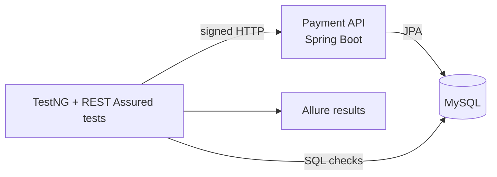
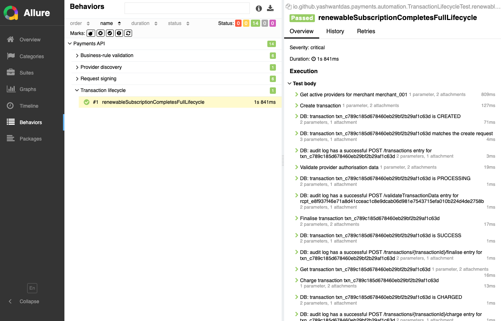

# qa-java-restassured-payments

A REST Assured and TestNG framework that tests a signed, stateful payment API end to end: every request is HMAC-signed, every transaction is walked through its full lifecycle, and the database is checked after each step.

[](https://github.com/yashwant-das/qa-java-restassured-payments/actions/workflows/ci.yml)
[](https://github.com/yashwant-das/qa-java-restassured-payments/actions/workflows/codeql.yml)
[](https://yashwant-das.github.io/qa-java-restassured-payments/)
[](LICENSE)
[](pom.xml)

## What this project demonstrates

- **Request signing in one filter.** [`SigningFilter`](automation/src/main/java/io/github/yashwantdas/payments/automation/api/SigningFilter.java) adds an API key, timestamp and HMAC-SHA256 signature to every call, with timestamps that stay unique across parallel threads.
- **A full lifecycle as one readable test.** [`TransactionLifecycleTest`](automation/src/test/java/io/github/yashwantdas/payments/automation/TransactionLifecycleTest.java) creates, authorises, finalises, charges, renews and cancels a subscription.
- **Database checks after every call.** [`DbAssertions`](automation/src/main/java/io/github/yashwantdas/payments/automation/db/DbAssertions.java) compares MySQL rows, the subscription and the audit log with each API response.
- **Security tests.** [`RequestSigningTest`](automation/src/test/java/io/github/yashwantdas/payments/automation/RequestSigningTest.java) covers a wrong key, missing headers, bad and expired timestamps, a wrong signature and a replayed request.
- **Evidence in CI.** Every push runs the suite in Docker and publishes an [Allure report](https://yashwant-das.github.io/qa-java-restassured-payments/) with each request, response and SQL check.

## Architecture



The API in [`backend/`](backend) is a small Spring Boot service written for this project as the system under test. The framework in [`automation/`](automation) calls it over HTTP and reads MySQL directly to confirm what the API wrote.



## Quickstart

You need Docker with Compose v2 and free ports 3306 and 8080. No Java install is needed.

```bash
git clone https://github.com/yashwant-das/qa-java-restassured-payments.git
cd qa-java-restassured-payments
docker compose up --build -d --wait mysql backend
docker compose --profile test up --build --abort-on-container-exit --exit-code-from tests tests
```

A passing run ends with `Tests run: 14, Failures: 0, Errors: 0, Skipped: 0` and `BUILD SUCCESS`. Stop everything with `docker compose --profile test down`.

Results are written to `automation/target/allure-results`. With Java 21 and Maven installed, `mvn -pl automation allure:serve` opens the report.

| Problem | Fix |
| --- | --- |
| `port is already allocated` | Stop whatever uses port 3306 or 8080 and retry. |
| Odd failures after changing code | Run `docker compose --profile test down`, then start again; `--build` picks up your changes. |

To run without Docker or from an IDE, see the [framework guide](docs/framework-guide.md#running-without-docker).

## Test coverage

| Test class | What it proves | Covers |
| --- | --- | --- |
| [`ProviderDiscoveryTest`](automation/src/test/java/io/github/yashwantdas/payments/automation/ProviderDiscoveryTest.java) | An active merchant sees active providers in the documented shape | `GET /providers`, JSON schema |
| [`TransactionLifecycleTest`](automation/src/test/java/io/github/yashwantdas/payments/automation/TransactionLifecycleTest.java) | A renewable subscription moves CREATED → PROCESSING → SUCCESS → CHARGED → RENEWED → CANCELLED, and the DB row, subscription and audit log match every step | All 8 endpoints |
| [`TransactionValidationTest`](automation/src/test/java/io/github/yashwantdas/payments/automation/TransactionValidationTest.java) | Business rules reject bad input | `INVALID_MERCHANT`, `INVALID_PROVIDER`, `VALIDATION_ERROR`, `INVALID_CURRENCY`, `INVALID_RECEIPT`, `DUPLICATE_FINALIZATION` |
| [`RequestSigningTest`](automation/src/test/java/io/github/yashwantdas/payments/automation/RequestSigningTest.java) | Unsigned, badly signed and replayed requests are refused | `INVALID_TOKEN`, `MISSING_SECURITY_HEADERS`, `INVALID_TIMESTAMP`, `EXPIRED_TIMESTAMP`, `INVALID_SIGNATURE`, `REPLAY_ATTACK_DETECTED` |

Tests run four at a time (TestNG `parallel="methods"`). Every DB check is keyed by its own transaction, so parallel runs and repeated runs don't interfere.

## Continuous integration

| Workflow | What it checks |
| --- | --- |
| [`ci.yml`](.github/workflows/ci.yml) | Compiles both modules and runs SpotBugs, then runs the quickstart commands, publishes test results on the PR and attaches the Allure report. On `main` the report is published to GitHub Pages. |
| [`codeql.yml`](.github/workflows/codeql.yml) | CodeQL analysis for Java, also weekly. |
| [`dependency-review.yml`](.github/workflows/dependency-review.yml) | Blocks PRs that add dependencies with known high or critical vulnerabilities. |

Dependabot keeps Maven dependencies, GitHub Actions and Docker images up to date.

## Project layout

```text
automation/   Test framework (src/main) and tests (src/test)
backend/      Payment API used as the system under test, with its schema and seed data
docs/         Framework guide
.github/      CI, CodeQL, dependency review, Dependabot
docker-compose.yml, Dockerfile.backend, Dockerfile.tests
```

## Tech stack

| Area | Tools |
| --- | --- |
| Tests | Java 21, REST Assured 5.5, TestNG 7.10, AssertJ, JSON Schema Validator |
| Database checks | HikariCP, MySQL Connector/J |
| Reporting | Allure 2.29 |
| System under test | Spring Boot 3.3, Spring Data JPA, MySQL 8.4 |
| Quality gates | SpotBugs, CodeQL, dependency review |
| Runtime | Docker Compose, GitHub Actions |

## Learn more

The [framework guide](docs/framework-guide.md) explains the design, the signing scheme, how to add a test and how to run without Docker.

## License

MIT. See [LICENSE](LICENSE).
