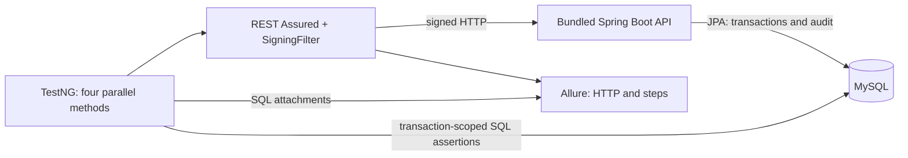

# Payments API Test Automation

Test a signed, stateful payment API from request to database record. This Java framework runs against a bundled Spring Boot service and checks the subscription lifecycle, rejected requests and persisted audit evidence, so a passing HTTP response is only part of the result.

[](https://github.com/yashwant-das/qa-java-restassured-payments/actions/workflows/ci.yml)
[](https://github.com/yashwant-das/qa-java-restassured-payments/actions/workflows/codeql.yml)
[](https://yashwant-das.github.io/qa-java-restassured-payments/)
[](pom.xml)
[](automation/pom.xml)
[](automation/src/test/resources/testng-suite.xml)
[](LICENSE)

## What this project demonstrates

- **Signed requests under parallel execution.** [`SigningFilter`](automation/src/main/java/com/qaframework/payments/automation/api/SigningFilter.java) adds HMAC-SHA256 headers and atomic, increasing timestamps to prevent accidental replay collisions between test threads.
- **A readable subscription lifecycle.** [`TransactionLifecycleTest`](automation/src/test/java/com/qaframework/payments/automation/TransactionLifecycleTest.java) creates, authorises, finalises, charges, renews and cancels a subscription, checking each state change in MySQL.
- **Persistence and audit evidence.** [`DbAssertions`](automation/src/main/java/com/qaframework/payments/automation/db/DbAssertions.java) checks transaction fields, subscription renewal/cancellation and successful audit entries, scoped by transaction ID or receipt.
- **Explicit rejection cases.** [`RequestSigningTest`](automation/src/test/java/com/qaframework/payments/automation/RequestSigningTest.java) tests invalid authentication, malformed/expired timestamps and replay; [`TransactionValidationTest`](automation/src/test/java/com/qaframework/payments/automation/TransactionValidationTest.java) checks business validation.
- **Inspectable results.** [`PaymentApi`](automation/src/main/java/com/qaframework/payments/automation/api/PaymentApi.java) and the SQL assertion layer attach HTTP exchanges, named steps and query results to Allure.

## Architecture



The `backend/` module is the system under test; `automation/` supplies the client, SQL assertions and tests. All eight endpoints run locally. Provider discovery and authorisation are simulated; no external payment gateway is contacted. The backend resets its tables on startup, so use only a disposable database. See [architecture and boundaries](docs/architecture.md).

### Project structure

```text
qa-java-restassured-payments/
├── automation/
│   ├── src/main/java/com/qaframework/payments/automation/
│   │   ├── api/             Endpoint client, signing and request records
│   │   ├── config/          Configuration overrides
│   │   ├── db/              JDBC pool and SQL assertions
│   │   └── support/         Seeded data and transaction setup
│   └── src/test/            TestNG tests, suite and JSON schemas
├── backend/src/main/        Spring Boot API, database schema and seed data
├── docs/                    Architecture, development and report image
├── .github/                 CI, CodeQL, dependency review and Dependabot
├── .mvn/                    Pinned Maven wrapper configuration
├── pom.xml                  Reactor, Java 21 and dependency/plugin versions
└── docker-compose.yml       MySQL, backend and test services
```

### Tech stack

| Layer | Tools | Version source |
| --- | --- | --- |
| Test client and assertions | Java 21, REST Assured, TestNG, AssertJ, JSON Schema Validator | [Parent POM](pom.xml) |
| Persistence checks | HikariCP, MySQL Connector/J | [Automation POM](automation/pom.xml) |
| System under test | Spring Boot, Spring Data JPA, MySQL 8.4 | [Backend POM](backend/pom.xml), [Compose](docker-compose.yml) |
| Reports | Allure, AspectJ steps | [Automation POM](automation/pom.xml) |
| Quality checks | pre-commit, Markdown lint, SpotBugs, CodeQL, dependency review | [Development guide](docs/development.md#quality-gates) |

## Quickstart

You need Docker with Compose v2 or later and free ports 3306 and 8080. The Docker route includes Java and Maven.

```bash
git clone https://github.com/yashwant-das/qa-java-restassured-payments.git
cd qa-java-restassured-payments
docker compose up --build -d --wait mysql backend
docker compose --profile test up --build --abort-on-container-exit --exit-code-from tests tests
```

The suite contains 14 test methods. The verified full run reports:

```text
Tests run: 14, Failures: 0, Errors: 0, Skipped: 0
BUILD SUCCESS
```

Results are written to `automation/target/allure-results`. Stop the stack with `docker compose --profile test down`. Docker-free and IDE setup are in the [development guide](docs/development.md#running-without-docker).

## Usage and coverage

With the backend and database running, use Java 21 and the Maven wrapper to run the suite or view the report:

```bash
./mvnw -pl automation test
./mvnw -pl automation allure:serve
```

| Test class | Cases | What it checks |
| --- | --- | --- |
| [`ProviderDiscoveryTest`](automation/src/test/java/com/qaframework/payments/automation/ProviderDiscoveryTest.java) | 1 | Active provider discovery and JSON schema |
| [`TransactionLifecycleTest`](automation/src/test/java/com/qaframework/payments/automation/TransactionLifecycleTest.java) | 1 | All 8 endpoints; CREATED → PROCESSING → SUCCESS → CHARGED → RENEWED → CANCELLED; SQL and audit assertions |
| [`TransactionValidationTest`](automation/src/test/java/com/qaframework/payments/automation/TransactionValidationTest.java) | 6 | `INVALID_MERCHANT`, `INVALID_PROVIDER`, `VALIDATION_ERROR`, `INVALID_CURRENCY`, `INVALID_RECEIPT`, `DUPLICATE_FINALIZATION` |
| [`RequestSigningTest`](automation/src/test/java/com/qaframework/payments/automation/RequestSigningTest.java) | 6 | `INVALID_TOKEN`, `MISSING_SECURITY_HEADERS`, `INVALID_TIMESTAMP`, `EXPIRED_TIMESTAMP`, `INVALID_SIGNATURE`, `REPLAY_ATTACK_DETECTED` |

[TestNG](automation/src/test/resources/testng-suite.xml) runs four methods at a time. Test data and database assertions are scoped to each transaction, allowing repeated runs against the same running backend.

## Verification and reports

The build/static checks run without payment services; dependency downloads need network access. API tests need the controlled MySQL/backend stack above. See [quality gates](docs/development.md#quality-gates) for local hook setup and commands shared with CI.

| Workflow | Automated scope |
| --- | --- |
| [CI](.github/workflows/ci.yml) | Full-file hooks and Markdown checks; Java compilation and SpotBugs; Docker API/MySQL suite; test summary and Allure artifacts |
| [CodeQL](.github/workflows/codeql.yml) | Java security/quality analysis on PRs, pushes to `main` and weekly |
| [Dependency review](.github/workflows/dependency-review.yml) | Rejects newly introduced known high/critical dependency vulnerabilities on PRs |

Successful checked pushes to `main` publish the [Allure report](https://yashwant-das.github.io/qa-java-restassured-payments/). Failed executions keep diagnostic artifacts. Workflow configuration does not by itself enforce merge protection; [verification evidence and pending settings](docs/development.md#verification-and-exceptions) distinguish those states.


## Documentation

- [Architecture](docs/architecture.md): packages, signing contract, lifecycle, SQL evidence, API reference and demo boundaries.
- [Development](docs/development.md): setup, overrides, adding tests, reports, troubleshooting and verification evidence.

## License

MIT. See [LICENSE](LICENSE).
