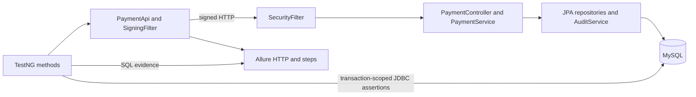

# Architecture

This Java 21 Maven reactor separates the system under test (`backend/`) from its HTTP client, SQL assertions and TestNG suite (`automation/`). Both use the same disposable MySQL database, through separate connection pools.

## Components and data flow

| Component | Responsibility | Detailed guide |
| --- | --- | --- |
| Backend | Security validation, endpoint routing, business rules, payment/subscription persistence and successful-call audit records | [Backend architecture](backend-architecture.md) |
| Automation | Request construction/signing, TestNG scenarios, independent SQL assertions and Allure evidence | [Test architecture](test-architecture.md) |
| MySQL | Seeded merchant/provider data, transactions, subscriptions and audit payloads | [Persistence and audit boundaries](backend-architecture.md#persistence-and-audit-boundaries) |
| Docker Compose and Maven | Disposable runtime stack and module build/test execution | [Development](development.md) |

## Execution and resource lifecycle

TestNG runs up to four methods concurrently. Each stateful scenario creates its own transaction; the client builds a fresh request specification per call, shares an atomic signing timestamp counter and uses a four-connection JDBC pool. Individual JDBC resources close after use; the automation pool lives for the JVM run. The backend has its own twelve-connection pool and a JVM-local replay cache. See [test concurrency](test-architecture.md#concurrency-and-resource-lifecycle) and [backend signing](backend-architecture.md#request-signing).

Backend startup drops and recreates all five tables and reloads seed data. Repeated tests against a running backend retain earlier rows; restarting the backend resets them. Setup and configuration live in [development](development.md).

## Boundaries and design trade-offs

The backend is a demonstration service. All eight endpoints run locally; provider discovery/authorisation are simulated, and no payment processor or browser checkout is contacted. The generated checkout URL uses `checkout.example.com`.

The automation checks both HTTP behavior and database state. Direct SQL assertions intentionally couple it to the demo schema, while transaction/receipt-scoped queries keep evidence attributable during parallel and repeated runs. HTTP and SQL attachments make failures inspectable but contain signed headers and local data.

The tested lifecycle is one supported scenario. The backend does not enforce every transition implied by a strict payment state machine, and its HMAC omits the body. Its replay cache is neither durable nor distributed. The [backend guide](backend-architecture.md#state-transitions) documents the actual rules and limitations; the [test guide](test-architecture.md#execution-and-evidence-flow) documents exercised behavior.

## Documentation ownership

The [backend architecture](backend-architecture.md) is authoritative for the signing/API contract, server components, state rules, schema and audit transaction boundaries. The [test architecture](test-architecture.md) explains client implementation, fixtures, assertions, concurrency and reporting. The [development guide](development.md) owns setup, overrides, extension instructions, quality gates and verification evidence.
