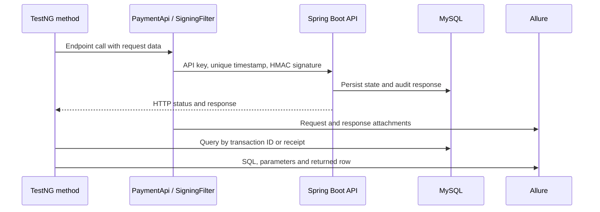

# Architecture

The automation checks a bundled payment API over HTTP and independently reads its MySQL state. See [development](development.md) for setup and extending the suite.

## Design choices

- **Four small packages.** Framework code is split by job: `config` reads settings, `api` talks HTTP, `db` reads MySQL, `support` builds test data. There are no base layers or wrappers beyond these.
- **Framework code in `src/main`.** The framework is a library the tests use, so it lives in `automation/src/main/java`. That also puts it under the SpotBugs check in CI, which skips test classes.
- **Tests read as scripts.** `TransactionLifecycleTest` lists the lifecycle steps in order; each step is an API call, a response check and a DB check. Nothing is hidden in a workflow class.
- **Explicit test data.** IDs come from the seed data and requests from small factories in `TestData`. The server generates transaction IDs, so tests need no random data and failures are easy to reproduce.
- **Raw responses.** `PaymentApi` returns REST Assured `Response` objects and tests assert with `then()`, so each test shows exactly what it checks.

## Packages

| Package | Classes | Job |
| --- | --- | --- |
| [`config`](../automation/src/main/java/com/qaframework/payments/automation/config) | `TestConfig` | Reads settings: system property, then environment variable, then `config.properties`. |
| [`api`](../automation/src/main/java/com/qaframework/payments/automation/api) | `PaymentApi`, `SigningFilter`, `model/*` | One method per endpoint; signing; request bodies as records. |
| [`db`](../automation/src/main/java/com/qaframework/payments/automation/db) | `Database`, `DbAssertions` | Connection pool; database checks that attach their SQL to the report. |
| [`support`](../automation/src/main/java/com/qaframework/payments/automation/support) | `TestData`, `Transactions` | Seeded IDs and request factories; setup that creates an authorised transaction. |

Tests live in [`automation/src/test/java`](../automation/src/test/java/com/qaframework/payments/automation) and extend `BaseApiTest`, which checks the database is reachable before the suite starts.

## Request signing

The security filter exempts paths beginning with `/actuator`; this project does not include an Actuator dependency. Other requests must carry three headers:

| Header | Value |
| --- | --- |
| `X-Api-Key` | The shared API key |
| `X-Timestamp` | Current time in epoch milliseconds; must be within 300 seconds of the server clock |
| `X-Signature` | Hex HMAC-SHA256, keyed with the signing secret, of `METHOD\nPATH\nQUERY\nTIMESTAMP` |

`PATH` and `QUERY` are the raw, still-encoded parts of the URL; `QUERY` is empty when there is none. For `GET /providers?merchantId=merchant_001` the signed string is:

```text
GET
/providers
merchantId=merchant_001
1760000000000
```

The API remembers each `timestamp:signature` pair and rejects a repeat with `409 REPLAY_ATTACK_DETECTED`. Because four tests run at once, two threads could sign in the same millisecond, so `SigningFilter.nextTimestamp()` always returns a value larger than the last one it gave out.

`RequestSigningTest` builds headers by hand on the unsigned spec (`PaymentApi.unsigned()`) to check each rejection, and signs one request with a fixed timestamp to send it twice for the replay check.

## Database checks

`TransactionLifecycleTest` checks MySQL after each state-changing call:

| After | Checked |
| --- | --- |
| Create | Status `CREATED`; merchant, provider, amount, currency, subscription, duration, renewable flag and request ID match the request |
| Provider validation | Status `PROCESSING` |
| Finalise, charge, renew, cancel | Status `SUCCESS`, `CHARGED`, `RENEWED`, `CANCELLED` |
| Each of the above | A `SUCCESS` audit-log entry for that endpoint |
| Cancel | Subscription `CANCELLED`, renewed at least once, next renewal date set |

The audit table has no transaction column, so `DbAssertions.auditLogged` matches the endpoint name and looks for the transaction ID (or, for provider validation, the receipt) in the logged response. Every check is keyed this way, which keeps parallel and repeated runs independent.

## Reporting

Allure records the calls each test makes:

- each `PaymentApi` and `DbAssertions` call as a named step (through the AspectJ agent configured in `automation/pom.xml`),
- the full request and response, including the signed headers (the official `AllureRestAssured` filter, added after `SigningFilter`),
- each SQL query, its parameters and the row it returned.

Open the latest report locally with `./mvnw -pl automation allure:serve` after a run. CI archives report artifacts after test execution. Publication to GitHub Pages is limited to successful checked pushes to `main`; failed runs retain diagnostic artifacts without replacing the published report.

## API reference

| Method | Path | Success | Purpose |
| --- | --- | --- | --- |
| GET | `/providers?merchantId=` | 200 | Active providers for an active merchant |
| POST | `/transactions` | 201 | Create a transaction; returns a redirect URL with `providerHash` |
| GET | `/transactions/{id}` | 200 | Current transaction state |
| POST | `/validateTransactionData` | 200 | Provider authorises with `providerHash` and PIN; returns a receipt |
| POST | `/transactions/{id}/finalise` | 200 | Confirm with the receipt → `SUCCESS` |
| POST | `/transactions/{id}/charge` | 200 | → `CHARGED` |
| POST | `/transactions/{id}/renew` | 200 | → `RENEWED` |
| DELETE | `/transactions/{id}/cancel` | 200 | → `CANCELLED` |

Error responses have the shape `{"code": "...", "message": "...", "timestamp": "..."}`. The codes the suite checks are listed in the README's test coverage table.

## Components and lifecycle



The supported subscription scenario follows `CREATED → PROCESSING → SUCCESS → CHARGED → RENEWED → CANCELLED`. This is a tested scenario, not a claim that the backend enforces every conceivable transition. The [controller](../backend/src/main/java/com/qaframework/payments/backend/controller/PaymentController.java) and [service](../backend/src/main/java/com/qaframework/payments/backend/service/PaymentService.java) define the actual rules.

TestNG runs methods on four threads. Each test creates its own client and transaction; the shared `SigningFilter` timestamp counter is atomic. The automation's shared Hikari pool allows four connections and closes individual JDBC connections/statements/results with try-with-resources. The backend has its own pool, capped at twelve connections. `BaseApiTest` checks database reachability before the suite; the JVM owns the automation pool for that run.

## Boundaries and trade-offs

- The backend is a demonstration system, with seeded merchants/providers and a generated checkout URL under `checkout.example.com`. Tests extract the provider hash and call the local authorisation endpoint; they do not contact a payment processor or complete a browser checkout.
- [Schema initialization](../backend/src/main/resources/db/schema.sql) drops and recreates all five tables on backend startup. Use a disposable `payments` database. Repeating tests against a running backend preserves prior rows; restarting the backend resets them.
- Request HMAC covers method, raw path, query and timestamp; it does not cover the JSON body. It demonstrates the implemented contract rather than a production payment-security scheme.
- The server's replay set is in memory, shared only within its JVM and cleared above 10,000 entries. It is not a durable or distributed replay store.
- Allure HTTP attachments include signed headers, and SQL attachments include local test data. Run with the documented demo credentials and review artifacts before using other environments.
- Direct SQL assertions deliberately couple tests to this schema so persistence errors remain visible. They do not replace independent business-level acceptance tests.
- SpotBugs checks framework and backend production classes; its existing `EI_EXPOSE_REP`/`EI_EXPOSE_REP2` suppression allows constructor-injected collaborators. See [the filter](../spotbugs-exclude.xml).
