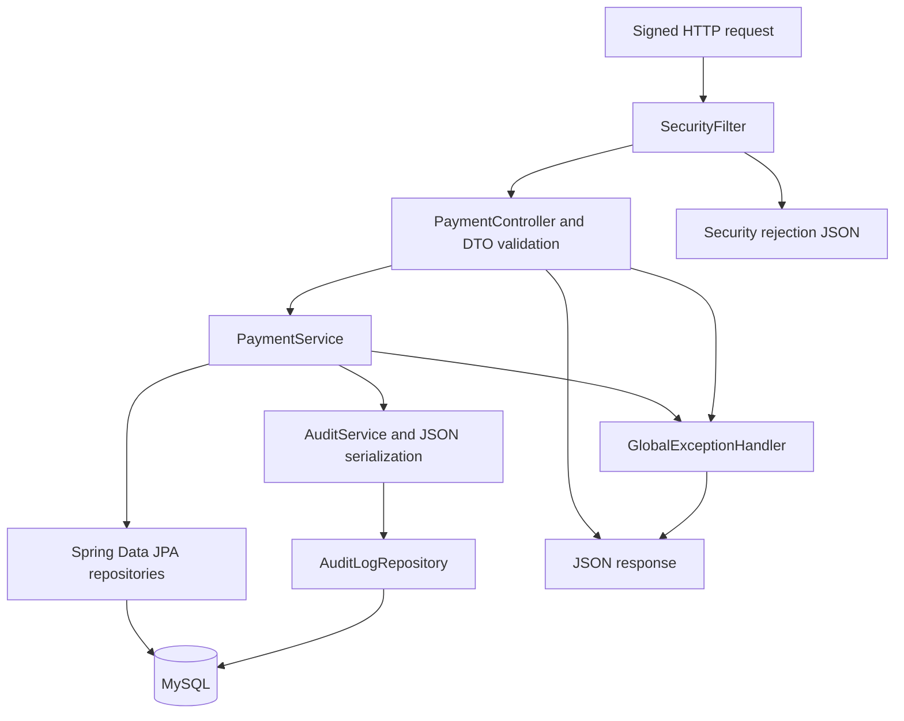

# Backend architecture

The `backend/` Maven module is a disposable Spring Boot system under test. It simulates payment and subscription operations using seeded merchants/providers and MySQL; it does not contact a payment gateway. See the [system architecture](architecture.md), [test architecture](test-architecture.md) and [development guide](development.md) for integration boundaries, assertions and setup.

## Components and request flow



| Package | Responsibility and source |
| --- | --- |
| `auth` | [`SecurityFilter`](../backend/src/main/java/com/qaframework/payments/backend/auth/SecurityFilter.java) checks API key, timestamp, HMAC and replay before controller execution; writes its own rejection response. |
| `controller`, `dto` | [`PaymentController`](../backend/src/main/java/com/qaframework/payments/backend/controller/PaymentController.java) maps eight endpoints, validates request records with `@Valid` and delegates to the service. |
| `service` | [`PaymentService`](../backend/src/main/java/com/qaframework/payments/backend/service/PaymentService.java) validates business inputs, generates IDs/hashes, changes transaction/subscription state and calls [`AuditService`](../backend/src/main/java/com/qaframework/payments/backend/service/AuditService.java). |
| `entity`, `repository`, `enums` | [Entities](../backend/src/main/java/com/qaframework/payments/backend/entity) map tables; [repositories](../backend/src/main/java/com/qaframework/payments/backend/repository) load/save them; [enums](../backend/src/main/java/com/qaframework/payments/backend/enums) represent persisted states. |
| `exception` | [`GlobalExceptionHandler`](../backend/src/main/java/com/qaframework/payments/backend/exception/GlobalExceptionHandler.java) maps business, bean-validation and unexpected exceptions to JSON. |
| `config`, `util` | [`SecurityProperties`](../backend/src/main/java/com/qaframework/payments/backend/config/SecurityProperties.java) holds server settings; [`CryptoUtil`](../backend/src/main/java/com/qaframework/payments/backend/util/CryptoUtil.java) supplies HMAC, SHA-256 and Base64 URL encoding. |

Spring manages the injected components. Requests use the shared service/repository beans; persistence uses the backend's Hikari pool, capped at twelve connections. There is no browser session or external provider client. Configuration defaults and overrides are maintained in [development](development.md#configuration).

## Request signing

The security filter exempts paths beginning with `/actuator`; this project does not include an Actuator dependency. Other requests must carry three headers:

| Header | Value |
| --- | --- |
| `X-Api-Key` | The shared API key |
| `X-Timestamp` | Epoch milliseconds within the configured server-clock tolerance (300 seconds by default) |
| `X-Signature` | Hex HMAC-SHA256, keyed with the signing secret, of `METHOD\nPATH\nQUERY\nTIMESTAMP` |

`PATH` and `QUERY` are the raw, still-encoded parts of the URL; `QUERY` is empty when there is none. For `GET /providers?merchantId=merchant_001` the signed string is:

```text
GET
/providers
merchantId=merchant_001
1760000000000
```

The API remembers each `timestamp:signature` pair and rejects a repeat with `409 REPLAY_ATTACK_DETECTED`. Because four tests run at once, two threads could sign in the same millisecond, so `SigningFilter.nextTimestamp()` always returns a value larger than the last one it gave out.

The filter checks the key first, then header presence, timestamp parsing/skew, signature and replay, in that order. The shared concurrent replay set is local to the JVM; it is cleared when its size exceeds 10,000 entries and disappears on restart. HMAC does not cover the JSON body. This is the implemented demo contract, with no durable or distributed replay protection.

## API reference

| Method | Path | Success | Purpose |
| --- | --- | --- | --- |
| GET | `/providers?merchantId=` | 200 | Active providers for an active merchant |
| POST | `/transactions` | 201 | Create a transaction; returns a redirect URL with `providerHash` |
| GET | `/transactions/{id}` | 200 | Current transaction state |
| POST | `/validateTransactionData` | 200 | Provider authorises with `providerHash` and PIN; returns a receipt |
| POST | `/transactions/{id}/finalise` | 200 | Confirm with the receipt → `SUCCESS` |
| POST | `/transactions/{id}/charge` | 200 | → `CHARGED` |
| POST | `/transactions/{id}/renew` | 200 | → `RENEWED` |
| DELETE | `/transactions/{id}/cancel` | 200 | → `CANCELLED` |

Errors handled by the API exception handlers and security filter have the shape `{"code": "...", "message": "...", "timestamp": "..."}`. The codes the suite checks are listed in the README's test coverage table.

## Payment and provider data

Creation requires an active merchant and provider, a positive amount (the request DTO requires at least `0.01`) and a supported currency: `USD`, `EUR`, `INR`, `GBP` or `SGD`. Currency is stored uppercase. Missing subscription/renewable flags become `false`; missing duration becomes one month. The current DTO does not constrain duration. Provider discovery validates the merchant and returns all active providers, with no merchant-provider association table.

Creation generates transaction and request IDs and, for subscriptions, an active subscription row with zero renewals and a next-renewal date based on duration. The redirect URL uses `checkout.example.com`; tests extract its `providerHash` and authorise locally.

The provider hash Base64 URL-encodes transaction ID, merchant ID, provider ID, amount, currency, provider type and an HMAC of those six fields. Authorisation checks the configured PIN, decodes the hash, loads the transaction/provider and compares the reconstructed hash. It returns `AUTHORIZED` with a deterministic receipt derived by HMAC from transaction ID, request ID and amount. Finalisation validates that receipt and stores its SHA-256 hash.

## State transitions

These are the rules in `PaymentService`, rather than an assumed linear payment state machine:

| Operation | Preconditions | Persisted result |
| --- | --- | --- |
| Create | Valid request and active merchant/provider | New transaction `CREATED`; optional subscription `ACTIVE` |
| Provider authorisation | Correct PIN and provider hash; no prior-state guard | Transaction `PROCESSING`; receipt returned |
| Finalise | Valid receipt; rejects `SUCCESS`, `CHARGED`, `RENEWED` as `DUPLICATE_FINALIZATION`, and `CANCELLED` as `TRANSACTION_CANCELLED` | Transaction `SUCCESS`; receipt hash stored. There is no explicit requirement to start in `PROCESSING`. |
| Charge | Transaction `SUCCESS` or `RENEWED` | Transaction `CHARGED` |
| Renew | Subscription and renewable flags true; transaction `CHARGED` or `SUCCESS`; subscription row exists | Transaction `RENEWED`; renewal count incremented and next date advanced by duration |
| Cancel | Transaction exists; no prior-state guard | Transaction `CANCELLED`; subscription set to `CANCELLED` if present |

The [lifecycle test](../automation/src/test/java/com/qaframework/payments/automation/TransactionLifecycleTest.java) exercises `CREATED → PROCESSING → SUCCESS → CHARGED → RENEWED → CANCELLED`. Authorisation can overwrite later transaction states, and cancellation can repeat. Renew does not separately check subscription status. These are demo limitations, not guarantees of a strict production state machine.

## Persistence and audit boundaries

[`schema.sql`](../backend/src/main/resources/db/schema.sql) defines five tables. Entities store ID fields rather than JPA object relationships; SQL foreign keys connect them:

| Table | Role and relationship |
| --- | --- |
| `merchants` | Seeded merchant identity and active/inactive status |
| `providers` | Seeded provider identity, type and status |
| `transactions` | Payment state and request/receipt metadata; foreign keys to merchant and provider |
| `subscriptions` | Renewal count, next date and subscription status; foreign key to transaction. The schema does not enforce a unique transaction ID here. |
| `audit_logs` | Endpoint name, serialized request/response, status and timestamp; no transaction foreign key |

`create`, `finalise`, `charge`, `renew` and `cancel` have service-level `@Transactional` boundaries. Their entity changes and successful audit write participate in the same transaction. `providers`, `status` and `validateProviderData` have no enclosing service transaction; repository operations use their own boundaries. In particular, provider authorisation can persist `PROCESSING` before a later audit write fails. There is no explicit row locking or optimistic version field for competing updates to the same transaction.

`AuditService` stores JSON request/response payloads and `SUCCESS` for completed service calls, including reads. Serialization failures produce a JSON fallback marker. Security rejections and exception-handler responses do not create failure audit rows. Tests correlate successful audit records by endpoint plus transaction ID or receipt in the response; see [database checks](test-architecture.md#database-checks).

## Errors

`ApiException` carries the HTTP status and business error code. Bean-validation failures become `400 VALIDATION_ERROR`; other exceptions handled by the catch-all become `500 INTERNAL_ERROR`, with the exception message. Security failures return `401` except replay, which returns `409`. All these paths use the error shape documented in the [API reference](#api-reference). The generic exception path is not a promise that every malformed input receives a specific business error code.

## Startup and demo boundaries

[`application.yml`](../backend/src/main/resources/application.yml) always initializes SQL, disables Hibernate schema generation and disables open-in-view. On every backend startup, the schema script drops and recreates all five tables, then [`seed-data.sql`](../backend/src/main/resources/db/seed-data.sql) inserts demo merchants/providers. Use only a disposable database. Repeating tests against a running backend retains rows; restarting resets them.

The backend has no real settlement, gateway integration, durable replay store or production credential scheme. Signed request headers and local data also appear in test reports. Review [configuration and artifact handling](development.md#configuration) before changing environments.
