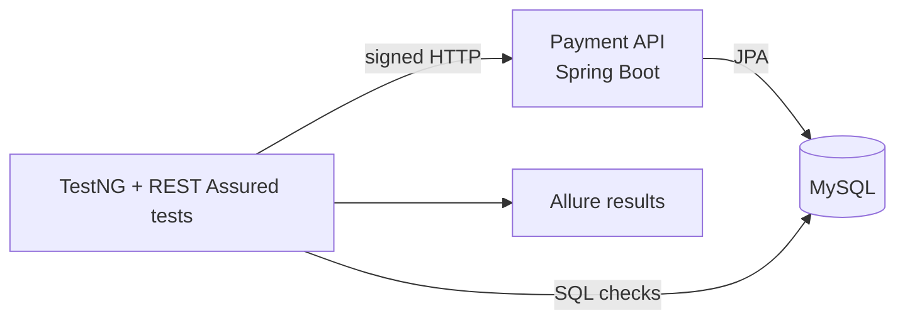

# Framework Simplification Implementation Plan

> **For agentic workers:** REQUIRED SUB-SKILL: Use superpowers:subagent-driven-development (recommended) or superpowers:executing-plans to implement this plan task-by-task. Steps use checkbox (`- [ ]`) syntax for tracking.

**Goal:** Turn the repo into a small, well-organised, unbranded REST Assured framework that keeps every core capability and is backed by honest docs.

**Architecture:** The backend (system under test) is renamed and deduplicated without behaviour changes. A new flat automation framework (`config`, `api`, `db`, `support`) is built next to the old one, the new tests are proven green, then the old code is deleted. Docs are rewritten last, from the finished code.

**Tech Stack:** Java 21, Spring Boot 3.3, MySQL 8.4, REST Assured 5.5, TestNG 7.10, AssertJ, Allure 2.29 (+ AspectJ weaver for `@Step`), HikariCP, Docker Compose v2, GitHub Actions.

**Spec:** `docs/superpowers/specs/2026-10-15-framework-simplification-design.md`

## Global Constraints

- Base packages: `io.github.yashwantdas.payments.backend` and `io.github.yashwantdas.payments.automation`.
- Auth headers: `X-Api-Key`, `X-Timestamp`, `X-Signature`.
- Env vars: `PAYMENTS_*` (plus `DB_URL`, `DB_USERNAME`, `DB_PASSWORD`); server port uses Spring's standard `SERVER_PORT`.
- No "PayFlowX", "Enterprise", "Distributed" or real company names anywhere in tracked files (git history excepted).
- Backend endpoints, request/response shapes, status codes and error codes do not change (only header names, IDs, and the redirect host change).
- Framework code lives in `automation/src/main/java` (SpotBugs analyses it).
- No JavaFaker, Lombok (automation), Awaitility or commons-lang3 in the automation module.
- Every dependency and plugin version is a property in the root `pom.xml`.
- TestNG runs `parallel="methods" thread-count="4"`.
- Final suite: 14 tests, `Tests run: 14, Failures: 0, Errors: 0, Skipped: 0`.
- Local-only credentials: API key `local-test-api-key`, signing secret `local-test-signing-secret`, provider PIN `4321`, DB `payments` / user `payments` / password `payments`.

## Review Focus

1. **Running the suite twice against the same backend without a restart.** The DB keeps rows from the first run; every DB and audit check must still pass because each is keyed by transaction ID or receipt. Pinned in Task 6, Step 6.
2. **Parallel threads signing in the same millisecond.** No spurious `409 REPLAY_ATTACK_DETECTED`; the monotonic timestamp must survive the rewrite. Pinned by the repeated parallel runs in Task 6, Step 6.
3. **Tests starting before the backend is ready.** `docker compose up --wait` must block until the backend's healthcheck passes, and the healthcheck must fail while the backend is down. Pinned in Task 2, Step 9.
4. **Config precedence.** Inside Docker the tests must use `PAYMENTS_BASE_URI=http://backend:8080`; from the host they must fall back to `config.properties` (`localhost`). Pinned in Task 6, Step 7 (host run).
5. **Allure evidence.** Request attachments must show the signed headers, security tests must have attachments, and `@Step` names must appear. Pinned in Task 6, Step 8.

## Prerequisites for every task

- Docker Desktop running, ports 3306 and 8080 free, Java 21 and Maven 3.9+ on the host.
- All commands run from the repo root: `/Users/yash/Workspace/GitHub/qa-java-restassured-payments`.
- Branch: `refactor/simplify-framework`.
- "Run the suite in Docker" always means:

```bash
docker compose --profile test down
docker compose up --build -d --wait mysql backend
docker compose --profile test up --build --abort-on-container-exit --exit-code-from tests tests
```

(Before Task 2 lands, `--wait` may return before the backend is ready because the old healthcheck always passes; if the first test run fails with connection errors, wait 10 seconds and rerun the last command.)

---

### Task 1: Single SQL source, MySQL only, neutral seed data

**Files:**
- Modify: `backend/src/main/resources/db/schema.sql`
- Modify: `backend/src/main/resources/db/seed-data.sql`
- Modify: `backend/src/main/resources/application.yml`
- Modify: `backend/pom.xml` (remove H2)
- Modify: `docker-compose.yml` (remove SQL init mounts)
- Delete: `docker/mysql/schema.sql`, `docker/mysql/seed-data.sql`, `docker/mysql/cleanup.sql`
- Modify: every file under `automation/src` that uses the old IDs

**Interfaces:**
- Produces: seeded IDs `merchant_001`, `merchant_002`, `merchant_inactive`, `provider_card_us`, `provider_card_eu`, `provider_upi_in`, `provider_wallet`, `provider_disabled`. Unknown-ID test values `merchant_missing`, `provider_missing`.

- [ ] **Step 1: Keep `ON UPDATE` in the backend schema**

In `backend/src/main/resources/db/schema.sql`, replace

```sql
    updated_at TIMESTAMP NOT NULL DEFAULT CURRENT_TIMESTAMP,
```

with

```sql
    updated_at TIMESTAMP NOT NULL DEFAULT CURRENT_TIMESTAMP ON UPDATE CURRENT_TIMESTAMP,
```

- [ ] **Step 2: Replace the seed data**

Overwrite `backend/src/main/resources/db/seed-data.sql` with:

```sql
INSERT INTO merchants (merchant_id, merchant_name, status, created_at) VALUES
('merchant_001', 'Demo Store', 'ACTIVE', CURRENT_TIMESTAMP),
('merchant_002', 'Demo Subscriptions', 'ACTIVE', CURRENT_TIMESTAMP),
('merchant_inactive', 'Inactive Merchant', 'INACTIVE', CURRENT_TIMESTAMP);

INSERT INTO providers (provider_id, provider_name, provider_type, status) VALUES
('provider_card_us', 'Card Gateway US', 'CARD', 'ACTIVE'),
('provider_card_eu', 'Card Gateway EU', 'CARD', 'ACTIVE'),
('provider_upi_in', 'UPI Gateway India', 'UPI', 'ACTIVE'),
('provider_wallet', 'Digital Wallet', 'WALLET', 'ACTIVE'),
('provider_disabled', 'Disabled Gateway', 'CARD', 'INACTIVE');
```

- [ ] **Step 3: Point the old automation code at the new IDs**

```bash
perl -pi -e 's/mrc_enterprise_001/merchant_001/g; s/mrc_missing/merchant_missing/g; s/prv_stripe_us/provider_card_us/g; s/prv_missing/provider_missing/g' $(git ls-files automation/src)
git grep -n -e 'mrc_' -e 'prv_' -- automation backend
```

Expected: the grep prints nothing.

- [ ] **Step 4: Drop H2 and default to local MySQL**

In `backend/pom.xml` delete the whole `com.h2database:h2` `<dependency>` block.

In `backend/src/main/resources/application.yml` replace the `datasource` block's first four keys:

```yaml
    url: ${DB_URL:jdbc:h2:mem:payflowx;MODE=MySQL;DATABASE_TO_LOWER=TRUE;DB_CLOSE_DELAY=-1}
    username: ${DB_USERNAME:sa}
    password: ${DB_PASSWORD:}
    driver-class-name: ${DB_DRIVER:org.h2.Driver}
```

with

```yaml
    url: ${DB_URL:jdbc:mysql://localhost:3306/payflowx?useSSL=false&allowPublicKeyRetrieval=true&serverTimezone=UTC}
    username: ${DB_USERNAME:payflowx}
    password: ${DB_PASSWORD:payflowx}
```

(The DB name is renamed in Task 2; the driver is detected from the URL.)

- [ ] **Step 5: Remove the duplicate SQL copies**

```bash
git rm docker/mysql/schema.sql docker/mysql/seed-data.sql docker/mysql/cleanup.sql
```

In `docker-compose.yml` delete the `mysql` service's `volumes:` key and its two `./docker/mysql/...` lines. Also delete the backend's `DB_DRIVER: com.mysql.cj.jdbc.Driver` line.

- [ ] **Step 6: Build and run the suite in Docker**

Run: `mvn -B -q -DskipTests verify` then the Docker commands from Prerequisites.
Expected: `Tests run: 11, Failures: 0, Errors: 0, Skipped: 0` and `BUILD SUCCESS`.

- [ ] **Step 7: Commit**

```bash
git add -A backend docker docker-compose.yml automation
git commit -m "Use the backend schema as the only SQL source and neutral seed IDs

Drops H2 and the docker/mysql copies (the backend recreates the schema at
startup) and keeps ON UPDATE for updated_at."
```

---

### Task 2: Remove the brand from the backend, build and Docker setup

**Files:**
- Move: `backend/src/main/java/com/payflowx/backend/**` → `backend/src/main/java/io/github/yashwantdas/payments/backend/**`
- Rename: `PayFlowXBackendApplication.java` → `PaymentsApiApplication.java`
- Modify: `backend/.../auth/SecurityFilter.java`, `backend/.../config/SecurityProperties.java`, `backend/.../service/PaymentService.java`, `backend/src/main/resources/application.yml`
- Modify: `pom.xml`, `backend/pom.xml`, `automation/pom.xml`
- Modify: `Dockerfile.backend`, `Dockerfile.tests`, `docker-compose.yml`
- Modify (old automation, kept working until Task 6): `automation/src/main/java/com/payflowx/automation/config/FrameworkConfig.java`, `.../filters/SecurityHeaderFilter.java`, `automation/src/test/java/com/payflowx/automation/regression/NegativePaymentApiTest.java`, `automation/src/test/resources/config/local.properties`

**Interfaces:**
- Produces: backend reads `X-Api-Key`, `X-Timestamp`, `X-Signature`; config `payments.security.{api-key,signing-secret,timestamp-skew-seconds,provider-pin}` from `PAYMENTS_API_KEY`, `PAYMENTS_SIGNING_SECRET`, `PAYMENTS_TIMESTAMP_SKEW_SECONDS`, `PAYMENTS_PROVIDER_PIN`. Jar `backend/target/payments-api-1.0.0.jar`. Maven coordinates `io.github.yashwantdas:payments-parent`, `payments-api`, `payments-automation`. Root properties `slf4j.version`, `logback.version`, `aspectj.version`, `surefire.version`, `allure.maven.version`, `compiler.plugin.version`.

- [ ] **Step 1: Move and rename the backend package**

```bash
mkdir -p backend/src/main/java/io/github/yashwantdas/payments
git mv backend/src/main/java/com/payflowx/backend backend/src/main/java/io/github/yashwantdas/payments/backend
git mv backend/src/main/java/io/github/yashwantdas/payments/backend/PayFlowXBackendApplication.java backend/src/main/java/io/github/yashwantdas/payments/backend/PaymentsApiApplication.java
perl -pi -e 's/com\.payflowx\.backend/io.github.yashwantdas.payments.backend/g; s/PayFlowXBackendApplication/PaymentsApiApplication/g' $(git ls-files backend/src)
```

- [ ] **Step 2: Rename the security properties**

Replace `backend/src/main/java/io/github/yashwantdas/payments/backend/config/SecurityProperties.java` with:

```java
package io.github.yashwantdas.payments.backend.config;

import org.springframework.boot.context.properties.ConfigurationProperties;

@ConfigurationProperties(prefix = "payments.security")
public record SecurityProperties(
        String apiKey,
        String signingSecret,
        long timestampSkewSeconds,
        String providerPin
) {
}
```

In `SecurityFilter.java` replace

```java
        String token = request.getHeader("x-access-token");
        String signature = request.getHeader("x-dp-signature");
        String timestamp = request.getHeader("x-dp-timestamp");
        if (!properties.accessToken().equals(token)) {
```

with

```java
        String apiKey = request.getHeader("X-Api-Key");
        String signature = request.getHeader("X-Signature");
        String timestamp = request.getHeader("X-Timestamp");
        if (!properties.apiKey().equals(apiKey)) {
```

Leave the `INVALID_TOKEN` error code unchanged (error codes are part of the API contract).

In `PaymentService.java` replace `https://checkout.payflowx.local/authorize?providerHash=` with `https://checkout.example.com/authorize?providerHash=`.

Run: `git grep -n -i -e accessToken -e payflowx -- backend/src`
Expected: no output.

- [ ] **Step 3: Replace `application.yml`**

Overwrite `backend/src/main/resources/application.yml` with:

```yaml
spring:
  application:
    name: payments-api
  datasource:
    url: ${DB_URL:jdbc:mysql://localhost:3306/payments?useSSL=false&allowPublicKeyRetrieval=true&serverTimezone=UTC}
    username: ${DB_USERNAME:payments}
    password: ${DB_PASSWORD:payments}
    hikari:
      maximum-pool-size: 12
      minimum-idle: 2
      pool-name: payments-api-db
  jpa:
    hibernate:
      ddl-auto: none
    open-in-view: false
    properties:
      hibernate:
        jdbc:
          time_zone: UTC
  sql:
    init:
      mode: always
      schema-locations: classpath:db/schema.sql
      data-locations: classpath:db/seed-data.sql

# Local-only defaults. Never reuse these values outside this project.
payments:
  security:
    api-key: ${PAYMENTS_API_KEY:local-test-api-key}
    signing-secret: ${PAYMENTS_SIGNING_SECRET:local-test-signing-secret}
    timestamp-skew-seconds: ${PAYMENTS_TIMESTAMP_SKEW_SECONDS:300}
    provider-pin: ${PAYMENTS_PROVIDER_PIN:4321}

logging:
  level:
    io.github.yashwantdas.payments: INFO
```

- [ ] **Step 4: Rename the Maven coordinates and centralise versions**

Overwrite the root `pom.xml` with:

```xml
<project xmlns="http://maven.apache.org/POM/4.0.0"
         xmlns:xsi="http://www.w3.org/2001/XMLSchema-instance"
         xsi:schemaLocation="http://maven.apache.org/POM/4.0.0 https://maven.apache.org/xsd/maven-4.0.0.xsd">
    <modelVersion>4.0.0</modelVersion>

    <groupId>io.github.yashwantdas</groupId>
    <artifactId>payments-parent</artifactId>
    <version>1.0.0</version>
    <packaging>pom</packaging>
    <name>Payments API test automation</name>
    <description>REST Assured and TestNG framework that tests a signed, stateful payment API end to end.</description>

    <modules>
        <module>backend</module>
        <module>automation</module>
    </modules>

    <properties>
        <java.version>21</java.version>
        <maven.compiler.release>21</maven.compiler.release>
        <project.build.sourceEncoding>UTF-8</project.build.sourceEncoding>

        <spring.boot.version>3.3.6</spring.boot.version>
        <lombok.version>1.18.48</lombok.version>
        <mysql.version>8.4.0</mysql.version>
        <hikari.version>5.1.0</hikari.version>

        <restassured.version>5.5.0</restassured.version>
        <testng.version>7.10.2</testng.version>
        <assertj.version>3.26.3</assertj.version>
        <jackson.version>2.17.2</jackson.version>
        <allure.version>2.29.0</allure.version>
        <aspectj.version>1.9.22.1</aspectj.version>
        <slf4j.version>2.0.16</slf4j.version>
        <logback.version>1.6.5</logback.version>

        <compiler.plugin.version>3.13.0</compiler.plugin.version>
        <surefire.version>3.5.2</surefire.version>
        <allure.maven.version>2.15.2</allure.maven.version>
        <spotbugs.plugin.version>4.10.4.1</spotbugs.plugin.version>
    </properties>

    <dependencyManagement>
        <dependencies>
            <dependency>
                <groupId>org.springframework.boot</groupId>
                <artifactId>spring-boot-dependencies</artifactId>
                <version>${spring.boot.version}</version>
                <type>pom</type>
                <scope>import</scope>
            </dependency>
            <dependency>
                <groupId>io.qameta.allure</groupId>
                <artifactId>allure-bom</artifactId>
                <version>${allure.version}</version>
                <type>pom</type>
                <scope>import</scope>
            </dependency>
        </dependencies>
    </dependencyManagement>

    <build>
        <pluginManagement>
            <plugins>
                <plugin>
                    <groupId>org.apache.maven.plugins</groupId>
                    <artifactId>maven-compiler-plugin</artifactId>
                    <version>${compiler.plugin.version}</version>
                    <configuration>
                        <release>${maven.compiler.release}</release>
                        <parameters>true</parameters>
                        <annotationProcessorPaths>
                            <path>
                                <groupId>org.projectlombok</groupId>
                                <artifactId>lombok</artifactId>
                                <version>${lombok.version}</version>
                            </path>
                        </annotationProcessorPaths>
                    </configuration>
                </plugin>
            </plugins>
        </pluginManagement>
        <plugins>
            <plugin>
                <groupId>com.github.spotbugs</groupId>
                <artifactId>spotbugs-maven-plugin</artifactId>
                <version>${spotbugs.plugin.version}</version>
                <configuration>
                    <effort>Max</effort>
                    <threshold>Medium</threshold>
                    <excludeFilterFile>${maven.multiModuleProjectDirectory}/spotbugs-exclude.xml</excludeFilterFile>
                    <xmlOutput>true</xmlOutput>
                </configuration>
                <executions>
                    <execution>
                        <id>spotbugs-check</id>
                        <phase>verify</phase>
                        <goals>
                            <goal>check</goal>
                        </goals>
                    </execution>
                </executions>
            </plugin>
        </plugins>
    </build>
</project>
```

In `backend/pom.xml`: set the parent to `io.github.yashwantdas` / `payments-parent` / `1.0.0`, `<artifactId>payments-api</artifactId>`, `<name>Payments API (system under test)</name>`.

In `automation/pom.xml`: set the same parent, `<artifactId>payments-automation</artifactId>`, `<name>Payments API automation</name>`. Replace the hard-coded versions: slf4j `2.0.16` → `${slf4j.version}`, both logback `1.6.5` → `${logback.version}`, surefire `3.5.2` → `${surefire.version}`, allure-maven `2.15.2` → `${allure.maven.version}`. (JavaFaker, Awaitility and commons-lang3 keep their literal versions until Task 6 deletes them.)

Run: `mvn -B -q -DskipTests verify && ls backend/target/payments-api-1.0.0.jar`
Expected: build succeeds and the jar path is printed.

- [ ] **Step 5: Keep the old automation code talking to the renamed backend**

```bash
perl -pi -e 's/x-access-token/X-Api-Key/g; s/x-dp-timestamp/X-Timestamp/g; s/x-dp-signature/X-Signature/g' \
  automation/src/main/java/com/payflowx/automation/filters/SecurityHeaderFilter.java \
  automation/src/test/java/com/payflowx/automation/regression/NegativePaymentApiTest.java
perl -pi -e 's/PAYFLOWX_BASE_URI/PAYMENTS_BASE_URI/; s/PAYFLOWX_ACCESS_TOKEN/PAYMENTS_API_KEY/; s/PAYFLOWX_SIGNING_SECRET/PAYMENTS_SIGNING_SECRET/; s/PAYFLOWX_PROVIDER_PIN/PAYMENTS_PROVIDER_PIN/' \
  automation/src/main/java/com/payflowx/automation/config/FrameworkConfig.java
```

Overwrite `automation/src/test/resources/config/local.properties` with:

```properties
base.uri=http://localhost:8080
access.token=local-test-api-key
signing.secret=local-test-signing-secret
provider.pin=4321
db.url=jdbc:mysql://localhost:3306/payments?useSSL=false&allowPublicKeyRetrieval=true&serverTimezone=UTC
db.username=payments
db.password=payments
```

- [ ] **Step 6: Replace `Dockerfile.backend`**

```dockerfile
FROM maven:3.9.9-eclipse-temurin-21 AS build
WORKDIR /workspace
COPY pom.xml .
COPY backend/pom.xml backend/pom.xml
COPY automation/pom.xml automation/pom.xml
# Download dependencies in their own layer so source edits don't re-download them.
RUN mvn -B -q -pl backend -am dependency:go-offline
COPY backend/src backend/src
RUN mvn -B -pl backend -am -DskipTests package

FROM eclipse-temurin:21-jre
RUN useradd --system --no-create-home app
WORKDIR /app
COPY --from=build /workspace/backend/target/payments-api-*.jar app.jar
USER app
EXPOSE 8080
ENTRYPOINT ["java", "-jar", "/app/app.jar"]
```

- [ ] **Step 7: Replace `Dockerfile.tests`**

```dockerfile
FROM maven:3.9.9-eclipse-temurin-21
WORKDIR /workspace
COPY pom.xml .
COPY backend/pom.xml backend/pom.xml
COPY automation/pom.xml automation/pom.xml
# Download dependencies in their own layer so source edits don't re-download them.
RUN mvn -B -q -pl automation dependency:go-offline
COPY automation/src automation/src
CMD ["mvn", "-B", "-pl", "automation", "test"]
```

- [ ] **Step 8: Replace `docker-compose.yml`**

```yaml
# Connection settings shared by the API and the tests. Security settings use the
# local-only defaults in application.yml and config.properties.
x-db: &db
  DB_URL: jdbc:mysql://mysql:3306/payments?useSSL=false&allowPublicKeyRetrieval=true&serverTimezone=UTC
  DB_USERNAME: payments
  DB_PASSWORD: payments

services:
  mysql:
    image: mysql:8.4
    environment:
      MYSQL_DATABASE: payments
      MYSQL_USER: payments
      MYSQL_PASSWORD: payments
      MYSQL_ROOT_PASSWORD: root
    ports:
      - "3306:3306"
    healthcheck:
      test: ["CMD-SHELL", "mysqladmin ping -h localhost -uroot -proot --silent"]
      interval: 5s
      timeout: 5s
      retries: 30

  backend:
    build:
      context: .
      dockerfile: Dockerfile.backend
    depends_on:
      mysql:
        condition: service_healthy
    environment:
      <<: *db
    ports:
      - "8080:8080"
    healthcheck:
      # The port only opens once Spring has started; any HTTP answer (even 401) means the API is up.
      test: ["CMD", "bash", "-c", "</dev/tcp/localhost/8080"]
      interval: 5s
      timeout: 3s
      retries: 30
      start_period: 10s

  tests:
    build:
      context: .
      dockerfile: Dockerfile.tests
    profiles: ["test"]
    depends_on:
      backend:
        condition: service_healthy
    environment:
      <<: *db
      PAYMENTS_BASE_URI: http://backend:8080
    volumes:
      - ./automation/target:/workspace/automation/target
```

- [ ] **Step 9: Prove the healthcheck gates startup (Review Focus 3)**

```bash
docker compose --profile test down
docker compose up --build -d --wait mysql backend
docker compose ps backend
```

Expected: `--wait` returns only after the backend shows `(healthy)`.

```bash
docker compose stop backend && docker compose start backend && docker compose ps backend
```

Expected: immediately after `start`, the status shows `(health: starting)`, not `(healthy)`.

- [ ] **Step 10: Run the suite in Docker**

Run the Docker commands from Prerequisites.
Expected: `Tests run: 11, Failures: 0, Errors: 0, Skipped: 0`.

- [ ] **Step 11: Commit**

```bash
git add -A
git commit -m "Remove PayFlowX branding from the API, build and Docker setup

Renames packages, Maven coordinates, headers, config and env vars, moves
every version into the root POM, caches Maven layers in both images, runs
the API as a non-root user and adds a real backend healthcheck."
```

---

### Task 3: CI runs the quickstart

**Files:**
- Delete: `.github/workflows/payflowx-ci.yml`
- Create: `.github/workflows/ci.yml`
- Modify: `README.md` (CI badge lines only; the full rewrite is Task 7)

**Interfaces:**
- Consumes: the Docker commands and `docker-compose.yml` from Task 2.
- Produces: workflow named `CI` at `.github/workflows/ci.yml`; artifacts `allure-report`, `allure-results`, `execution-logs`, `spotbugs-reports`.

- [ ] **Step 1: Replace the workflow**

```bash
git rm .github/workflows/payflowx-ci.yml
```

Create `.github/workflows/ci.yml`:

```yaml
name: CI

on:
  push:
    branches: ["main"]
  pull_request:
    branches: ["main"]
  workflow_dispatch:

permissions:
  contents: read

concurrency:
  group: ${{ github.workflow }}-${{ github.ref }}
  cancel-in-progress: ${{ github.event_name == 'pull_request' }}

jobs:
  static-analysis:
    name: Build and static analysis
    runs-on: ubuntu-latest
    timeout-minutes: 15
    steps:
      - uses: actions/checkout@v7
      - uses: actions/setup-java@v6
        with:
          distribution: temurin
          java-version: "21"
          cache: maven

      - name: Compile and run SpotBugs
        run: mvn -B -DskipTests verify

      - name: Archive SpotBugs reports
        uses: actions/upload-artifact@v7
        if: failure()
        with:
          name: spotbugs-reports
          path: "**/target/spotbugsXml.xml"

  api-tests:
    name: API tests
    runs-on: ubuntu-latest
    timeout-minutes: 30
    permissions:
      contents: read
      checks: write
    steps:
      - uses: actions/checkout@v7
      - uses: actions/setup-java@v6
        with:
          distribution: temurin
          java-version: "21"
          cache: maven

      # The same commands as the README quickstart.
      - name: Start MySQL and the API
        run: docker compose up --build -d --wait mysql backend

      - name: Run API tests
        run: docker compose --profile test up --build --abort-on-container-exit --exit-code-from tests tests

      - name: Collect API logs
        if: always()
        run: docker compose logs backend > backend.log

      - name: Take ownership of test output
        if: always()
        run: sudo chown -R "$(id -u):$(id -g)" automation/target

      - name: Publish test summary
        uses: mikepenz/action-junit-report@v6
        if: always()
        with:
          report_paths: automation/target/surefire-reports/TEST-*.xml
          check_name: API test results
          detailed_summary: true
          include_passed: true

      - name: Generate Allure report
        if: always()
        run: mvn -B -pl automation allure:report

      - name: Archive Allure report
        uses: actions/upload-artifact@v7
        if: always()
        with:
          name: allure-report
          path: automation/target/site/allure-maven-plugin

      - name: Upload Allure report for GitHub Pages
        uses: actions/upload-pages-artifact@v5
        if: github.event_name == 'push' && github.ref == 'refs/heads/main' && always()
        with:
          path: automation/target/site/allure-maven-plugin

      - name: Archive Allure results
        uses: actions/upload-artifact@v7
        if: always()
        with:
          name: allure-results
          path: automation/target/allure-results

      - name: Archive logs
        uses: actions/upload-artifact@v7
        if: always()
        with:
          name: execution-logs
          path: |
            backend.log
            automation/target/logs

      - name: Stop containers
        if: always()
        run: docker compose --profile test down

  publish-report:
    name: Publish Allure report
    needs: api-tests
    if: github.event_name == 'push' && github.ref == 'refs/heads/main' && !cancelled()
    runs-on: ubuntu-latest
    timeout-minutes: 10
    permissions:
      pages: write
      id-token: write
    environment:
      name: github-pages
      url: ${{ steps.deployment.outputs.page_url }}
    steps:
      - name: Deploy to GitHub Pages
        id: deployment
        uses: actions/deploy-pages@v5
```

- [ ] **Step 2: Point the README badge at the new workflow**

```bash
perl -pi -e 's/payflowx-ci\.yml/ci.yml/g; s/\[!\[PayFlowX CI\]/[![CI]/' README.md
git grep -n 'payflowx-ci' -- .
```

Expected: the grep prints nothing.

- [ ] **Step 3: Validate the workflow locally**

Run: `command -v actionlint && actionlint .github/workflows/ci.yml || ruby -ryaml -e 'YAML.load_file(".github/workflows/ci.yml"); puts "yaml ok"'`
Expected: no actionlint findings, or `yaml ok` if actionlint is not installed. The full check is CI on the pull request (Task 8).

- [ ] **Step 4: Commit**

```bash
git add -A .github README.md
git commit -m "Run the README quickstart in CI

The API test job now uses the same docker compose commands as local runs, so
CI no longer keeps its own copies of the schema and environment settings."
```

---

### Task 4: New framework core, smoke test and lifecycle test

**Files:**
- Create: `automation/src/main/java/io/github/yashwantdas/payments/automation/config/TestConfig.java`
- Create: `.../automation/api/SigningFilter.java`, `.../api/PaymentApi.java`
- Create: `.../automation/api/model/CreateTransactionRequest.java`, `FinaliseRequest.java`, `ValidateRequest.java`
- Create: `.../automation/db/Database.java`, `.../db/DbAssertions.java`
- Create: `.../automation/support/TestData.java`, `.../support/Transactions.java`
- Create: `automation/src/test/java/io/github/yashwantdas/payments/automation/BaseApiTest.java`, `ProviderDiscoveryTest.java`, `TransactionLifecycleTest.java`
- Create: `automation/src/test/resources/config.properties`
- Modify: `automation/pom.xml` (add allure-rest-assured, aspectjweaver, surefire javaagent)
- Modify: `automation/src/test/resources/testng-suite.xml` (run both packages during the transition)

(`.../automation/` below means `automation/src/main/java/io/github/yashwantdas/payments/automation/`.)

**Interfaces:**
- Produces (used by Task 5):
  - `TestConfig.baseUri()`, `apiKey()`, `signingSecret()`, `providerPin()`, `dbUrl()`, `dbUsername()`, `dbPassword()`: all `static String`.
  - `SigningFilter.sign(String method, String path, String query, String timestamp): String`; `SigningFilter.nextTimestamp(): String`.
  - `PaymentApi.signed()`, `PaymentApi.unsigned()`: `static RequestSpecification`. Instance methods returning `Response`: `getProviders(String merchantId)`, `createTransaction(CreateTransactionRequest)`, `getTransaction(String transactionId)`, `validateProviderData(ValidateRequest)`, `finalise(String transactionId, String receipt)`, `charge(String transactionId)`, `renew(String transactionId)`, `cancel(String transactionId)`.
  - Records `CreateTransactionRequest(String itemDescription, BigDecimal amount, String currency, String merchantId, String providerId, Boolean subscription, Integer duration, Boolean isRenewable)`, `FinaliseRequest(String receipt)`, `ValidateRequest(String providerHash, String password)`.
  - `Database.queryOne(String sql, Object... params): Map<String, Object>`.
  - `DbAssertions.transactionStatus(String, String)`, `transactionMatches(String transactionId, String requestId, CreateTransactionRequest)`, `subscriptionRenewedAndCancelled(String)`, `auditLogged(String apiName, String payloadValue)`.
  - `TestData.MERCHANT`, `PROVIDER`, `UNKNOWN_MERCHANT`, `UNKNOWN_PROVIDER`; `TestData.renewableSubscription(String providerId)`, `TestData.oneOffPayment(BigDecimal amount, String currency)`.
  - `Transactions.createAndAuthorise(PaymentApi): Transactions.Authorised(String transactionId, String receipt)`; `Transactions.providerHash(String redirectUrl): String`.
  - `BaseApiTest` (abstract, `@BeforeSuite` environment check).

- [ ] **Step 1: Write the two new tests first**

`automation/src/test/java/io/github/yashwantdas/payments/automation/BaseApiTest.java`:

```java
package io.github.yashwantdas.payments.automation;

import io.github.yashwantdas.payments.automation.db.Database;
import io.restassured.RestAssured;
import org.testng.annotations.BeforeSuite;

public abstract class BaseApiTest {
    @BeforeSuite(alwaysRun = true)
    public void checkEnvironment() {
        RestAssured.enableLoggingOfRequestAndResponseIfValidationFails();
        Database.queryOne("SELECT 1 AS ok");
    }
}
```

`automation/src/test/java/io/github/yashwantdas/payments/automation/ProviderDiscoveryTest.java`:

```java
package io.github.yashwantdas.payments.automation;

import io.github.yashwantdas.payments.automation.api.PaymentApi;
import io.github.yashwantdas.payments.automation.support.TestData;
import io.qameta.allure.Epic;
import io.qameta.allure.Feature;
import org.testng.annotations.Test;

import static io.restassured.module.jsv.JsonSchemaValidator.matchesJsonSchemaInClasspath;
import static org.hamcrest.Matchers.equalTo;
import static org.hamcrest.Matchers.greaterThan;

@Epic("Payments API")
@Feature("Provider discovery")
public class ProviderDiscoveryTest extends BaseApiTest {
    private final PaymentApi api = new PaymentApi();

    @Test(groups = {"smoke", "regression"})
    public void activeMerchantSeesActiveProviders() {
        api.getProviders(TestData.MERCHANT).then()
                .statusCode(200)
                .body(matchesJsonSchemaInClasspath("schemas/providers.schema.json"))
                .body("size()", greaterThan(0))
                .body("[0].status", equalTo("ACTIVE"));
    }
}
```

`automation/src/test/java/io/github/yashwantdas/payments/automation/TransactionLifecycleTest.java`:

```java
package io.github.yashwantdas.payments.automation;

import io.github.yashwantdas.payments.automation.api.PaymentApi;
import io.github.yashwantdas.payments.automation.api.model.CreateTransactionRequest;
import io.github.yashwantdas.payments.automation.api.model.ValidateRequest;
import io.github.yashwantdas.payments.automation.config.TestConfig;
import io.github.yashwantdas.payments.automation.db.DbAssertions;
import io.github.yashwantdas.payments.automation.support.TestData;
import io.github.yashwantdas.payments.automation.support.Transactions;
import io.qameta.allure.Epic;
import io.qameta.allure.Feature;
import io.qameta.allure.Severity;
import io.qameta.allure.SeverityLevel;
import io.restassured.response.Response;
import org.testng.annotations.Test;

import static io.restassured.module.jsv.JsonSchemaValidator.matchesJsonSchemaInClasspath;
import static org.assertj.core.api.Assertions.assertThat;
import static org.hamcrest.Matchers.containsString;
import static org.hamcrest.Matchers.equalTo;

@Epic("Payments API")
@Feature("Transaction lifecycle")
public class TransactionLifecycleTest extends BaseApiTest {
    private final PaymentApi api = new PaymentApi();

    @Test(groups = {"smoke", "regression"})
    @Severity(SeverityLevel.CRITICAL)
    public void renewableSubscriptionCompletesFullLifecycle() {
        // 1. Discover a provider
        String providerId = api.getProviders(TestData.MERCHANT).then()
                .statusCode(200)
                .body(matchesJsonSchemaInClasspath("schemas/providers.schema.json"))
                .extract().path("[0].providerId");

        // 2. Create the transaction
        CreateTransactionRequest request = TestData.renewableSubscription(providerId);
        Response created = api.createTransaction(request).then()
                .statusCode(201)
                .body(matchesJsonSchemaInClasspath("schemas/create-transaction.schema.json"))
                .body("redirectURL", containsString("providerHash="))
                .extract().response();
        String transactionId = created.path("transactionId");
        String requestId = created.path("requestId");
        DbAssertions.transactionStatus(transactionId, "CREATED");
        DbAssertions.transactionMatches(transactionId, requestId, request);
        DbAssertions.auditLogged("POST /transactions", transactionId);

        // 3. Provider authorises it
        String providerHash = Transactions.providerHash(created.path("redirectURL"));
        String receipt = api.validateProviderData(new ValidateRequest(providerHash, TestConfig.providerPin())).then()
                .statusCode(200)
                .extract().path("receipt");
        DbAssertions.transactionStatus(transactionId, "PROCESSING");
        DbAssertions.auditLogged("POST /validateTransactionData", receipt);

        // 4. Finalise
        api.finalise(transactionId, receipt).then().statusCode(200).body("status", equalTo("SUCCESS"));
        DbAssertions.transactionStatus(transactionId, "SUCCESS");
        DbAssertions.auditLogged("POST /transactions/{transactionId}/finalise", transactionId);
        api.getTransaction(transactionId).then().statusCode(200).body("status", equalTo("SUCCESS"));

        // 5. Charge
        api.charge(transactionId).then().statusCode(200).body("status", equalTo("CHARGED"));
        DbAssertions.transactionStatus(transactionId, "CHARGED");
        DbAssertions.auditLogged("POST /transactions/{transactionId}/charge", transactionId);

        // 6. Renew
        api.renew(transactionId).then().statusCode(200).body("status", equalTo("RENEWED"));
        DbAssertions.transactionStatus(transactionId, "RENEWED");
        DbAssertions.auditLogged("POST /transactions/{transactionId}/renew", transactionId);

        // 7. Cancel
        api.cancel(transactionId).then().statusCode(200).body("status", equalTo("CANCELLED"));
        DbAssertions.transactionStatus(transactionId, "CANCELLED");
        DbAssertions.auditLogged("DELETE /transactions/{transactionId}/cancel", transactionId);

        // 8. Final state
        DbAssertions.subscriptionRenewedAndCancelled(transactionId);
        assertThat(transactionId).startsWith("txn_");
        assertThat(requestId).startsWith("req_");
        assertThat(receipt).startsWith("rcpt_");
    }
}
```

- [ ] **Step 2: Confirm they fail to compile**

Run: `mvn -B -q -pl automation test-compile`
Expected: FAIL with `package io.github.yashwantdas.payments.automation.api does not exist`.

- [ ] **Step 3: Add the dependencies and AspectJ agent**

In `automation/pom.xml`, add after the `allure-testng` dependency:

```xml
        <dependency>
            <groupId>io.qameta.allure</groupId>
            <artifactId>allure-rest-assured</artifactId>
        </dependency>
        <dependency>
            <groupId>org.aspectj</groupId>
            <artifactId>aspectjweaver</artifactId>
            <version>${aspectj.version}</version>
            <scope>test</scope>
        </dependency>
```

Replace the surefire `<argLine>` with:

```xml
                    <!-- The AspectJ agent makes Allure record @Step methods as report steps. -->
                    <argLine>-Dfile.encoding=UTF-8 -javaagent:"${settings.localRepository}/org/aspectj/aspectjweaver/${aspectj.version}/aspectjweaver-${aspectj.version}.jar"</argLine>
```

- [ ] **Step 4: Add the test configuration file**

`automation/src/test/resources/config.properties`:

```properties
# Local-only defaults matching docker-compose.yml and application.yml. Never reuse them elsewhere.
# Override any key with a system property (-Dbase.uri=...) or its environment variable.
base.uri=http://localhost:8080
api.key=local-test-api-key
signing.secret=local-test-signing-secret
provider.pin=4321
db.url=jdbc:mysql://localhost:3306/payments?useSSL=false&allowPublicKeyRetrieval=true&serverTimezone=UTC
db.username=payments
db.password=payments
```

- [ ] **Step 5: Write `TestConfig`**

```java
package io.github.yashwantdas.payments.automation.config;

import java.io.IOException;
import java.io.InputStream;
import java.io.UncheckedIOException;
import java.util.Properties;

/**
 * Test settings. Each value comes from a system property, then its environment variable,
 * then {@code config.properties} on the test classpath.
 */
public final class TestConfig {
    private static final Properties FILE = load("config.properties");

    private TestConfig() {
    }

    public static String baseUri() {
        return get("base.uri", "PAYMENTS_BASE_URI");
    }

    public static String apiKey() {
        return get("api.key", "PAYMENTS_API_KEY");
    }

    public static String signingSecret() {
        return get("signing.secret", "PAYMENTS_SIGNING_SECRET");
    }

    public static String providerPin() {
        return get("provider.pin", "PAYMENTS_PROVIDER_PIN");
    }

    public static String dbUrl() {
        return get("db.url", "DB_URL");
    }

    public static String dbUsername() {
        return get("db.username", "DB_USERNAME");
    }

    public static String dbPassword() {
        return get("db.password", "DB_PASSWORD");
    }

    private static String get(String key, String envVar) {
        String value = System.getProperty(key, System.getenv(envVar));
        if (value == null) {
            value = FILE.getProperty(key);
        }
        if (value == null || value.isBlank()) {
            throw new IllegalStateException("Missing setting " + key + " (or environment variable " + envVar + ")");
        }
        return value;
    }

    private static Properties load(String resource) {
        Properties properties = new Properties();
        try (InputStream in = TestConfig.class.getClassLoader().getResourceAsStream(resource)) {
            if (in != null) {
                properties.load(in);
            }
        } catch (IOException ex) {
            throw new UncheckedIOException("Cannot read " + resource, ex);
        }
        return properties;
    }
}
```

- [ ] **Step 6: Write the request records**

`.../automation/api/model/CreateTransactionRequest.java`:

```java
package io.github.yashwantdas.payments.automation.api.model;

import java.math.BigDecimal;

/** Body of {@code POST /transactions}. */
public record CreateTransactionRequest(
        String itemDescription,
        BigDecimal amount,
        String currency,
        String merchantId,
        String providerId,
        Boolean subscription,
        Integer duration,
        Boolean isRenewable
) {
}
```

`.../automation/api/model/FinaliseRequest.java`:

```java
package io.github.yashwantdas.payments.automation.api.model;

/** Body of {@code POST /transactions/{id}/finalise}. */
public record FinaliseRequest(String receipt) {
}
```

`.../automation/api/model/ValidateRequest.java`:

```java
package io.github.yashwantdas.payments.automation.api.model;

/** Body of {@code POST /validateTransactionData}: the provider hash from the redirect URL and the provider PIN. */
public record ValidateRequest(String providerHash, String password) {
}
```

- [ ] **Step 7: Write `SigningFilter`**

```java
package io.github.yashwantdas.payments.automation.api;

import io.github.yashwantdas.payments.automation.config.TestConfig;
import io.restassured.filter.Filter;
import io.restassured.filter.FilterContext;
import io.restassured.response.Response;
import io.restassured.specification.FilterableRequestSpecification;
import io.restassured.specification.FilterableResponseSpecification;
import org.slf4j.Logger;
import org.slf4j.LoggerFactory;

import javax.crypto.Mac;
import javax.crypto.spec.SecretKeySpec;
import java.net.URI;
import java.nio.charset.StandardCharsets;
import java.security.GeneralSecurityException;
import java.time.Instant;
import java.util.HexFormat;
import java.util.concurrent.atomic.AtomicLong;

/**
 * Signs every request the way the API requires: {@code X-Api-Key}, an epoch-millisecond {@code X-Timestamp}
 * and an HMAC-SHA256 {@code X-Signature} over {@code METHOD\nPATH\nQUERY\nTIMESTAMP}. Also logs each call's timing.
 */
public final class SigningFilter implements Filter {
    private static final Logger log = LoggerFactory.getLogger(SigningFilter.class);

    // The API rejects a repeated timestamp+signature as a replay, and parallel tests can sign in the
    // same millisecond, so timestamps are kept strictly increasing across threads.
    private static final AtomicLong LAST_TIMESTAMP = new AtomicLong();

    @Override
    public Response filter(FilterableRequestSpecification request,
                           FilterableResponseSpecification response,
                           FilterContext ctx) {
        URI uri = URI.create(request.getURI());
        String timestamp = nextTimestamp();
        request.header("X-Api-Key", TestConfig.apiKey());
        request.header("X-Timestamp", timestamp);
        request.header("X-Signature", sign(request.getMethod(), uri.getRawPath(), uri.getRawQuery(), timestamp));

        long started = System.nanoTime();
        Response result = ctx.next(request, response);
        log.info("{} {} -> {} in {} ms", request.getMethod(), uri, result.statusCode(),
                (System.nanoTime() - started) / 1_000_000);
        return result;
    }

    /** A timestamp later than every one handed out before, so no two signed requests share one. */
    public static String nextTimestamp() {
        return Long.toString(LAST_TIMESTAMP.updateAndGet(last -> Math.max(last + 1, Instant.now().toEpochMilli())));
    }

    /** HMAC-SHA256 signature, hex encoded, for the given request parts. {@code query} may be null. */
    public static String sign(String method, String path, String query, String timestamp) {
        String canonical = method + "\n" + path + "\n" + (query == null ? "" : query) + "\n" + timestamp;
        try {
            Mac mac = Mac.getInstance("HmacSHA256");
            mac.init(new SecretKeySpec(TestConfig.signingSecret().getBytes(StandardCharsets.UTF_8), "HmacSHA256"));
            return HexFormat.of().formatHex(mac.doFinal(canonical.getBytes(StandardCharsets.UTF_8)));
        } catch (GeneralSecurityException ex) {
            throw new IllegalStateException("Cannot sign request", ex);
        }
    }
}
```

- [ ] **Step 8: Write `PaymentApi`**

```java
package io.github.yashwantdas.payments.automation.api;

import io.github.yashwantdas.payments.automation.api.model.CreateTransactionRequest;
import io.github.yashwantdas.payments.automation.api.model.FinaliseRequest;
import io.github.yashwantdas.payments.automation.api.model.ValidateRequest;
import io.github.yashwantdas.payments.automation.config.TestConfig;
import io.qameta.allure.Step;
import io.qameta.allure.restassured.AllureRestAssured;
import io.restassured.builder.RequestSpecBuilder;
import io.restassured.http.ContentType;
import io.restassured.response.Response;
import io.restassured.specification.RequestSpecification;

import static io.restassured.RestAssured.given;

/**
 * One method per endpoint of the payment API. Requests are signed by {@link SigningFilter} and
 * attached to the Allure report. Methods return the raw response so tests make their own assertions.
 */
public class PaymentApi {
    private static final String TRANSACTION = "/transactions/{transactionId}";

    /** Base spec for normal calls. SigningFilter runs before AllureRestAssured so attachments show the signed headers. */
    public static RequestSpecification signed() {
        return base().addFilter(new SigningFilter()).addFilter(new AllureRestAssured()).build();
    }

    /** Base spec without auth headers, for security tests that set them by hand. */
    public static RequestSpecification unsigned() {
        return base().addFilter(new AllureRestAssured()).build();
    }

    private static RequestSpecBuilder base() {
        return new RequestSpecBuilder()
                .setBaseUri(TestConfig.baseUri())
                .setContentType(ContentType.JSON)
                .setAccept(ContentType.JSON);
    }

    @Step("Get active providers for merchant {merchantId}")
    public Response getProviders(String merchantId) {
        return given(signed()).queryParam("merchantId", merchantId).get("/providers");
    }

    @Step("Create transaction")
    public Response createTransaction(CreateTransactionRequest request) {
        return given(signed()).body(request).post("/transactions");
    }

    @Step("Get transaction {transactionId}")
    public Response getTransaction(String transactionId) {
        return given(signed()).get(TRANSACTION, transactionId);
    }

    @Step("Validate provider authorisation data")
    public Response validateProviderData(ValidateRequest request) {
        return given(signed()).body(request).post("/validateTransactionData");
    }

    @Step("Finalise transaction {transactionId}")
    public Response finalise(String transactionId, String receipt) {
        return given(signed()).body(new FinaliseRequest(receipt)).post(TRANSACTION + "/finalise", transactionId);
    }

    @Step("Charge transaction {transactionId}")
    public Response charge(String transactionId) {
        return given(signed()).post(TRANSACTION + "/charge", transactionId);
    }

    @Step("Renew transaction {transactionId}")
    public Response renew(String transactionId) {
        return given(signed()).post(TRANSACTION + "/renew", transactionId);
    }

    @Step("Cancel transaction {transactionId}")
    public Response cancel(String transactionId) {
        return given(signed()).delete(TRANSACTION + "/cancel", transactionId);
    }
}
```

- [ ] **Step 9: Write `Database`**

```java
package io.github.yashwantdas.payments.automation.db;

import com.zaxxer.hikari.HikariConfig;
import com.zaxxer.hikari.HikariDataSource;
import io.github.yashwantdas.payments.automation.config.TestConfig;
import org.slf4j.Logger;
import org.slf4j.LoggerFactory;

import java.sql.Connection;
import java.sql.PreparedStatement;
import java.sql.ResultSet;
import java.sql.ResultSetMetaData;
import java.sql.SQLException;
import java.util.Arrays;
import java.util.LinkedHashMap;
import java.util.Map;

/** Shared MySQL connection pool and a single-row query helper for database checks. */
public final class Database {
    private static final Logger log = LoggerFactory.getLogger(Database.class);
    private static final HikariDataSource DATA_SOURCE = createDataSource();

    private Database() {
    }

    /** Runs a parameterised query and returns its first row (column label to value), or an empty map. */
    public static Map<String, Object> queryOne(String sql, Object... params) {
        log.info("sql={} params={}", sql, Arrays.toString(params));
        try (Connection connection = DATA_SOURCE.getConnection();
             PreparedStatement statement = connection.prepareStatement(sql)) {
            for (int i = 0; i < params.length; i++) {
                statement.setObject(i + 1, params[i]);
            }
            try (ResultSet resultSet = statement.executeQuery()) {
                if (!resultSet.next()) {
                    return Map.of();
                }
                ResultSetMetaData meta = resultSet.getMetaData();
                Map<String, Object> row = new LinkedHashMap<>();
                for (int i = 1; i <= meta.getColumnCount(); i++) {
                    row.put(meta.getColumnLabel(i), resultSet.getObject(i));
                }
                return row;
            }
        } catch (SQLException ex) {
            throw new IllegalStateException("Query failed: " + sql, ex);
        }
    }

    private static HikariDataSource createDataSource() {
        HikariConfig config = new HikariConfig();
        config.setJdbcUrl(TestConfig.dbUrl());
        config.setUsername(TestConfig.dbUsername());
        config.setPassword(TestConfig.dbPassword());
        config.setMaximumPoolSize(4);
        config.setPoolName("automation-db");
        return new HikariDataSource(config);
    }
}
```

- [ ] **Step 10: Write `DbAssertions`**

```java
package io.github.yashwantdas.payments.automation.db;

import io.github.yashwantdas.payments.automation.api.model.CreateTransactionRequest;
import io.qameta.allure.Allure;
import io.qameta.allure.Step;

import java.math.BigDecimal;
import java.util.Arrays;
import java.util.Map;

import static org.assertj.core.api.Assertions.assertThat;

/**
 * Database checks used by the tests. Each check reads one row, attaches the query and result
 * to the Allure report, and asserts on it. Every check is keyed by a transaction ID or receipt,
 * so checks stay correct when tests run in parallel or the database holds earlier runs.
 */
public final class DbAssertions {
    private DbAssertions() {
    }

    @Step("DB: transaction {transactionId} is {expectedStatus}")
    public static void transactionStatus(String transactionId, String expectedStatus) {
        Map<String, Object> row = read(
                "SELECT status, created_at, updated_at FROM transactions WHERE transaction_id = ?", transactionId);
        assertThat(row).as("transactions row for %s", transactionId).containsEntry("status", expectedStatus);
        assertThat(row.get("created_at")).as("created_at").isNotNull();
        assertThat(row.get("updated_at")).as("updated_at").isNotNull();
    }

    @Step("DB: transaction {transactionId} matches the create request")
    public static void transactionMatches(String transactionId, String requestId, CreateTransactionRequest request) {
        Map<String, Object> row = read(
                "SELECT merchant_id, provider_id, amount, currency, subscription, duration, is_renewable, request_id"
                        + " FROM transactions WHERE transaction_id = ?",
                transactionId);
        assertThat(row).as("transactions row for %s", transactionId)
                .containsEntry("merchant_id", request.merchantId())
                .containsEntry("provider_id", request.providerId())
                .containsEntry("currency", request.currency())
                .containsEntry("request_id", requestId);
        assertThat((BigDecimal) row.get("amount")).isEqualByComparingTo(request.amount());
        assertThat(((Number) row.get("duration")).intValue()).isEqualTo(request.duration());
        assertThat(asBoolean(row.get("subscription"))).isEqualTo(request.subscription());
        assertThat(asBoolean(row.get("is_renewable"))).isEqualTo(request.isRenewable());
    }

    @Step("DB: subscription for {transactionId} was renewed and cancelled")
    public static void subscriptionRenewedAndCancelled(String transactionId) {
        Map<String, Object> row = read(
                "SELECT renewal_count, next_renewal_date, status FROM subscriptions WHERE transaction_id = ?",
                transactionId);
        assertThat(row).as("subscriptions row for %s", transactionId).containsEntry("status", "CANCELLED");
        assertThat(((Number) row.get("renewal_count")).intValue()).isGreaterThanOrEqualTo(1);
        assertThat(row.get("next_renewal_date")).isNotNull();
    }

    /** Asserts a SUCCESS audit entry exists for {@code apiName} whose response payload contains {@code payloadValue}. */
    @Step("DB: audit log has a successful {apiName} entry for {payloadValue}")
    public static void auditLogged(String apiName, String payloadValue) {
        Map<String, Object> row = read(
                "SELECT COUNT(*) AS total FROM audit_logs"
                        + " WHERE api_name = ? AND status = 'SUCCESS' AND INSTR(response_payload, ?) > 0",
                apiName, payloadValue);
        assertThat(((Number) row.get("total")).longValue())
                .as("audit entries for %s containing %s", apiName, payloadValue)
                .isPositive();
    }

    private static Map<String, Object> read(String sql, Object... params) {
        Map<String, Object> row = Database.queryOne(sql, params);
        Allure.addAttachment("SQL", "text/plain",
                sql + "\nparams: " + Arrays.toString(params) + "\nresult: " + row, ".txt");
        return row;
    }

    private static boolean asBoolean(Object value) {
        return value instanceof Boolean flag ? flag : ((Number) value).intValue() != 0;
    }
}
```

- [ ] **Step 11: Write `TestData` and `Transactions`**

`.../automation/support/TestData.java`:

```java
package io.github.yashwantdas.payments.automation.support;

import io.github.yashwantdas.payments.automation.api.model.CreateTransactionRequest;

import java.math.BigDecimal;

/** Seeded IDs (see backend/src/main/resources/db/seed-data.sql) and request factories. */
public final class TestData {
    public static final String MERCHANT = "merchant_001";
    public static final String PROVIDER = "provider_card_us";
    public static final String UNKNOWN_MERCHANT = "merchant_missing";
    public static final String UNKNOWN_PROVIDER = "provider_missing";

    private TestData() {
    }

    /** A one-month renewable subscription for {@link #MERCHANT}. */
    public static CreateTransactionRequest renewableSubscription(String providerId) {
        return new CreateTransactionRequest(
                "Monthly plan", new BigDecimal("49.99"), "USD", MERCHANT, providerId, true, 1, true);
    }

    /** A single payment for {@link #MERCHANT} through {@link #PROVIDER}. */
    public static CreateTransactionRequest oneOffPayment(BigDecimal amount, String currency) {
        return new CreateTransactionRequest(
                "One-off payment", amount, currency, MERCHANT, PROVIDER, false, 1, false);
    }
}
```

`.../automation/support/Transactions.java`:

```java
package io.github.yashwantdas.payments.automation.support;

import io.github.yashwantdas.payments.automation.api.PaymentApi;
import io.github.yashwantdas.payments.automation.api.model.ValidateRequest;
import io.github.yashwantdas.payments.automation.config.TestConfig;
import io.qameta.allure.Step;
import io.restassured.response.Response;

import java.net.URI;
import java.net.URLDecoder;
import java.nio.charset.StandardCharsets;
import java.util.Arrays;

/** Setup shared by tests that need a transaction in a given state. */
public final class Transactions {
    private Transactions() {
    }

    /** A transaction the provider has authorised, ready to finalise with {@code receipt}. */
    public record Authorised(String transactionId, String receipt) {
    }

    @Step("Create a transaction and authorise it with the provider")
    public static Authorised createAndAuthorise(PaymentApi api) {
        Response created = api.createTransaction(TestData.renewableSubscription(TestData.PROVIDER)).then()
                .statusCode(201)
                .extract().response();
        String receipt = api.validateProviderData(
                        new ValidateRequest(providerHash(created.path("redirectURL")), TestConfig.providerPin()))
                .then().statusCode(200)
                .extract().path("receipt");
        return new Authorised(created.path("transactionId"), receipt);
    }

    /** Extracts the {@code providerHash} query parameter from the checkout redirect URL. */
    public static String providerHash(String redirectUrl) {
        String query = URI.create(redirectUrl).getRawQuery();
        return Arrays.stream(query == null ? new String[0] : query.split("&"))
                .map(pair -> pair.split("=", 2))
                .filter(parts -> parts.length == 2 && parts[0].equals("providerHash"))
                .map(parts -> URLDecoder.decode(parts[1], StandardCharsets.UTF_8))
                .findFirst()
                .orElseThrow(() -> new IllegalArgumentException("providerHash missing from " + redirectUrl));
    }
}
```

- [ ] **Step 12: Run both packages during the transition**

In `automation/src/test/resources/testng-suite.xml`, add inside `<packages>` after the existing line:

```xml
            <package name="io.github.yashwantdas.payments.automation"/>
```

- [ ] **Step 13: Compile and run SpotBugs**

Run: `mvn -B -q -DskipTests verify`
Expected: `BUILD SUCCESS`. If SpotBugs reports a finding in the new code, fix the code (don't add an exclusion) and rerun.

- [ ] **Step 14: Run the suite in Docker**

Run the Docker commands from Prerequisites.
Expected: `Tests run: 13, Failures: 0, Errors: 0, Skipped: 0` (11 old + 2 new).

- [ ] **Step 15: Commit**

```bash
git add -A automation
git commit -m "Add the flat automation framework with smoke and lifecycle tests

config, api, db and support packages replace the old layered classes. The
lifecycle test reads as one script and checks audit entries per transaction.
Adds the official Allure REST Assured filter and the AspectJ agent so @Step
methods show up in reports."
```

---

### Task 5: Validation and request-signing tests

**Files:**
- Create: `automation/src/test/java/io/github/yashwantdas/payments/automation/TransactionValidationTest.java`
- Create: `automation/src/test/java/io/github/yashwantdas/payments/automation/RequestSigningTest.java`

**Interfaces:**
- Consumes: everything in Task 4's Produces list.

These tests pin behaviour the backend already has (see `backend/.../auth/SecurityFilter.java` and `PaymentService.java`), so they are expected to pass on the first run once they compile. If one fails, read the backend code before changing the test; never weaken an assertion to make it pass.

- [ ] **Step 1: Write `TransactionValidationTest`**

```java
package io.github.yashwantdas.payments.automation;

import io.github.yashwantdas.payments.automation.api.PaymentApi;
import io.github.yashwantdas.payments.automation.support.TestData;
import io.github.yashwantdas.payments.automation.support.Transactions;
import io.qameta.allure.Epic;
import io.qameta.allure.Feature;
import org.testng.annotations.Test;

import java.math.BigDecimal;

import static org.hamcrest.Matchers.equalTo;

@Epic("Payments API")
@Feature("Business-rule validation")
public class TransactionValidationTest extends BaseApiTest {
    private final PaymentApi api = new PaymentApi();

    @Test(groups = "regression")
    public void unknownMerchantIsRejected() {
        api.getProviders(TestData.UNKNOWN_MERCHANT).then()
                .statusCode(404)
                .body("code", equalTo("INVALID_MERCHANT"));
    }

    @Test(groups = "regression")
    public void unknownProviderIsRejected() {
        api.createTransaction(TestData.renewableSubscription(TestData.UNKNOWN_PROVIDER)).then()
                .statusCode(404)
                .body("code", equalTo("INVALID_PROVIDER"));
    }

    @Test(groups = "regression")
    public void zeroAmountIsRejected() {
        api.createTransaction(TestData.oneOffPayment(BigDecimal.ZERO, "USD")).then()
                .statusCode(400)
                .body("code", equalTo("VALIDATION_ERROR"));
    }

    @Test(groups = "regression")
    public void unsupportedCurrencyIsRejected() {
        api.createTransaction(TestData.oneOffPayment(BigDecimal.TEN, "BTC")).then()
                .statusCode(400)
                .body("code", equalTo("INVALID_CURRENCY"));
    }

    @Test(groups = "regression")
    public void invalidReceiptIsRejected() {
        Transactions.Authorised txn = Transactions.createAndAuthorise(api);
        api.finalise(txn.transactionId(), "rcpt_invalid").then()
                .statusCode(400)
                .body("code", equalTo("INVALID_RECEIPT"));
    }

    @Test(groups = "regression")
    public void secondFinalisationIsRejected() {
        Transactions.Authorised txn = Transactions.createAndAuthorise(api);
        api.finalise(txn.transactionId(), txn.receipt()).then().statusCode(200);
        api.finalise(txn.transactionId(), txn.receipt()).then()
                .statusCode(409)
                .body("code", equalTo("DUPLICATE_FINALIZATION"));
    }
}
```

- [ ] **Step 2: Write `RequestSigningTest`**

```java
package io.github.yashwantdas.payments.automation;

import io.github.yashwantdas.payments.automation.api.PaymentApi;
import io.github.yashwantdas.payments.automation.api.SigningFilter;
import io.github.yashwantdas.payments.automation.config.TestConfig;
import io.github.yashwantdas.payments.automation.support.TestData;
import io.qameta.allure.Epic;
import io.qameta.allure.Feature;
import io.restassured.response.Response;
import org.testng.annotations.Test;

import java.time.Instant;
import java.util.Map;

import static io.restassured.RestAssured.given;
import static org.hamcrest.Matchers.equalTo;

/** Sends hand-built auth headers to {@code GET /providers} and checks each rejection. */
@Epic("Payments API")
@Feature("Request signing")
public class RequestSigningTest extends BaseApiTest {

    @Test(groups = "regression")
    public void wrongApiKeyIsRejected() {
        getProviders(Map.of("X-Api-Key", "wrong-key", "X-Timestamp", now(), "X-Signature", "unused")).then()
                .statusCode(401)
                .body("code", equalTo("INVALID_TOKEN"));
    }

    @Test(groups = "regression")
    public void missingSignatureHeadersAreRejected() {
        getProviders(Map.of("X-Api-Key", TestConfig.apiKey())).then()
                .statusCode(401)
                .body("code", equalTo("MISSING_SECURITY_HEADERS"));
    }

    @Test(groups = "regression")
    public void nonNumericTimestampIsRejected() {
        getProviders(Map.of("X-Api-Key", TestConfig.apiKey(), "X-Timestamp", "yesterday", "X-Signature", "unused")).then()
                .statusCode(401)
                .body("code", equalTo("INVALID_TIMESTAMP"));
    }

    @Test(groups = "regression")
    public void expiredTimestampIsRejected() {
        String hourAgo = Long.toString(Instant.now().minusSeconds(3600).toEpochMilli());
        getProviders(Map.of("X-Api-Key", TestConfig.apiKey(), "X-Timestamp", hourAgo, "X-Signature", "unused")).then()
                .statusCode(401)
                .body("code", equalTo("EXPIRED_TIMESTAMP"));
    }

    @Test(groups = "regression")
    public void wrongSignatureIsRejected() {
        getProviders(Map.of("X-Api-Key", TestConfig.apiKey(), "X-Timestamp", now(), "X-Signature", "wrong-signature")).then()
                .statusCode(401)
                .body("code", equalTo("INVALID_SIGNATURE"));
    }

    @Test(groups = "regression")
    public void replayedRequestIsRejected() {
        String timestamp = SigningFilter.nextTimestamp();
        String signature = SigningFilter.sign("GET", "/providers", "merchantId=" + TestData.MERCHANT, timestamp);
        Map<String, String> headers = Map.of(
                "X-Api-Key", TestConfig.apiKey(), "X-Timestamp", timestamp, "X-Signature", signature);

        getProviders(headers).then().statusCode(200);
        getProviders(headers).then()
                .statusCode(409)
                .body("code", equalTo("REPLAY_ATTACK_DETECTED"));
    }

    private static Response getProviders(Map<String, String> headers) {
        return given(PaymentApi.unsigned())
                .headers(headers)
                .queryParam("merchantId", TestData.MERCHANT)
                .get("/providers");
    }

    private static String now() {
        return Long.toString(Instant.now().toEpochMilli());
    }
}
```

- [ ] **Step 3: Compile**

Run: `mvn -B -q -pl automation test-compile`
Expected: success.

- [ ] **Step 4: Run the suite in Docker**

Run the Docker commands from Prerequisites.
Expected: `Tests run: 25, Failures: 0, Errors: 0, Skipped: 0` (11 old + 14 new).

- [ ] **Step 5: Commit**

```bash
git add automation/src/test/java/io/github/yashwantdas/payments/automation
git commit -m "Add validation and request-signing tests to the new framework

Covers every security rejection the API makes, including missing headers,
a non-numeric timestamp and a replayed request, with Allure evidence."
```

---

### Task 6: Remove the old framework

**Files:**
- Delete: `automation/src/main/java/com/payflowx/**`, `automation/src/test/java/com/payflowx/**`
- Delete: `automation/src/test/resources/config/local.properties`, `environment.properties`, `payloads/create-transaction-template.json`, `testdata/payment-testdata.json`, `sql/cleanup.sql`
- Modify: `automation/pom.xml` (final dependency list)
- Modify: `automation/src/test/resources/testng-suite.xml`, `logback.xml`
- Modify: `automation/src/test/resources/schemas/providers.schema.json`, `create-transaction.schema.json`

**Interfaces:**
- Consumes: Tasks 4 and 5 (the new suite must already be green).

- [ ] **Step 1: Delete the old code and unused resources**

```bash
git rm -r -q automation/src/main/java/com/payflowx automation/src/test/java/com/payflowx
git rm -q automation/src/test/resources/config/local.properties \
  automation/src/test/resources/environment.properties \
  automation/src/test/resources/payloads/create-transaction-template.json \
  automation/src/test/resources/testdata/payment-testdata.json \
  automation/src/test/resources/sql/cleanup.sql
```

- [ ] **Step 2: Final automation `pom.xml`**

Overwrite `automation/pom.xml` with:

```xml
<project xmlns="http://maven.apache.org/POM/4.0.0"
         xmlns:xsi="http://www.w3.org/2001/XMLSchema-instance"
         xsi:schemaLocation="http://maven.apache.org/POM/4.0.0 https://maven.apache.org/xsd/maven-4.0.0.xsd">
    <modelVersion>4.0.0</modelVersion>
    <parent>
        <groupId>io.github.yashwantdas</groupId>
        <artifactId>payments-parent</artifactId>
        <version>1.0.0</version>
    </parent>

    <artifactId>payments-automation</artifactId>
    <name>Payments API automation</name>

    <dependencies>
        <dependency>
            <groupId>io.rest-assured</groupId>
            <artifactId>rest-assured</artifactId>
            <version>${restassured.version}</version>
        </dependency>
        <dependency>
            <groupId>io.rest-assured</groupId>
            <artifactId>json-schema-validator</artifactId>
            <version>${restassured.version}</version>
        </dependency>
        <dependency>
            <!-- Serialises the request records -->
            <groupId>com.fasterxml.jackson.core</groupId>
            <artifactId>jackson-databind</artifactId>
            <version>${jackson.version}</version>
        </dependency>
        <dependency>
            <groupId>org.testng</groupId>
            <artifactId>testng</artifactId>
            <version>${testng.version}</version>
        </dependency>
        <dependency>
            <groupId>org.assertj</groupId>
            <artifactId>assertj-core</artifactId>
            <version>${assertj.version}</version>
        </dependency>
        <dependency>
            <groupId>io.qameta.allure</groupId>
            <artifactId>allure-testng</artifactId>
        </dependency>
        <dependency>
            <groupId>io.qameta.allure</groupId>
            <artifactId>allure-rest-assured</artifactId>
        </dependency>
        <dependency>
            <groupId>com.zaxxer</groupId>
            <artifactId>HikariCP</artifactId>
            <version>${hikari.version}</version>
        </dependency>
        <dependency>
            <groupId>com.mysql</groupId>
            <artifactId>mysql-connector-j</artifactId>
            <version>${mysql.version}</version>
        </dependency>
        <dependency>
            <groupId>org.slf4j</groupId>
            <artifactId>slf4j-api</artifactId>
            <version>${slf4j.version}</version>
        </dependency>
        <dependency>
            <groupId>ch.qos.logback</groupId>
            <artifactId>logback-classic</artifactId>
            <version>${logback.version}</version>
        </dependency>
        <dependency>
            <groupId>org.aspectj</groupId>
            <artifactId>aspectjweaver</artifactId>
            <version>${aspectj.version}</version>
            <scope>test</scope>
        </dependency>
    </dependencies>

    <build>
        <plugins>
            <plugin>
                <groupId>org.apache.maven.plugins</groupId>
                <artifactId>maven-surefire-plugin</artifactId>
                <version>${surefire.version}</version>
                <configuration>
                    <suiteXmlFiles>
                        <suiteXmlFile>src/test/resources/testng-suite.xml</suiteXmlFile>
                    </suiteXmlFiles>
                    <systemPropertyVariables>
                        <allure.results.directory>${project.build.directory}/allure-results</allure.results.directory>
                    </systemPropertyVariables>
                    <!-- The AspectJ agent makes Allure record @Step methods as report steps. -->
                    <argLine>-Dfile.encoding=UTF-8 -javaagent:"${settings.localRepository}/org/aspectj/aspectjweaver/${aspectj.version}/aspectjweaver-${aspectj.version}.jar"</argLine>
                </configuration>
            </plugin>
            <plugin>
                <groupId>io.qameta.allure</groupId>
                <artifactId>allure-maven</artifactId>
                <version>${allure.maven.version}</version>
            </plugin>
        </plugins>
    </build>
</project>
```

- [ ] **Step 3: Final suite, logging and schemas**

Overwrite `automation/src/test/resources/testng-suite.xml`:

```xml
<!DOCTYPE suite SYSTEM "https://testng.org/testng-1.0.dtd">
<suite name="Payments API tests" parallel="methods" thread-count="4" verbose="1">
    <listeners>
        <listener class-name="io.qameta.allure.testng.AllureTestNg"/>
    </listeners>
    <test name="API tests">
        <packages>
            <package name="io.github.yashwantdas.payments.automation"/>
        </packages>
    </test>
</suite>
```

Overwrite `automation/src/test/resources/logback.xml`:

```xml
<configuration>
    <property name="PATTERN" value="%d{ISO8601} %-5level [%thread] %logger{36} - %msg%n"/>
    <appender name="STDOUT" class="ch.qos.logback.core.ConsoleAppender">
        <encoder>
            <pattern>${PATTERN}</pattern>
        </encoder>
    </appender>
    <appender name="FILE" class="ch.qos.logback.core.FileAppender">
        <file>target/logs/automation.log</file>
        <encoder>
            <pattern>${PATTERN}</pattern>
        </encoder>
    </appender>
    <root level="INFO">
        <appender-ref ref="STDOUT"/>
        <appender-ref ref="FILE"/>
    </root>
</configuration>
```

In both files under `automation/src/test/resources/schemas/`, replace

```json
  "$schema": "https://json-schema.org/draft/2020-12/schema",
```

with

```json
  "$schema": "http://json-schema.org/draft-04/schema#",
```

- [ ] **Step 4: Check nothing still references the old code or brand**

```bash
git grep -n -i -e payflowx -e 'com\.payflowx' -e javafaker -e lombok -- automation
```

Expected: no output.

- [ ] **Step 5: Build and run SpotBugs**

Run: `mvn -B -q -DskipTests verify`
Expected: `BUILD SUCCESS`.

- [ ] **Step 6: Run the suite in Docker, then twice more without restarting the API (Review Focus 1 and 2)**

Run the Docker commands from Prerequisites.
Expected: `Tests run: 14, Failures: 0, Errors: 0, Skipped: 0`.

Then, without `down`, rerun twice:

```bash
docker compose --profile test up --build --abort-on-container-exit --exit-code-from tests tests
docker compose --profile test up --abort-on-container-exit --exit-code-from tests tests
```

Expected: both runs end with `Tests run: 14, Failures: 0`. The DB now holds three runs of data, and no test may fail because of it, and no `REPLAY_ATTACK_DETECTED` may appear outside `replayedRequestIsRejected`.

- [ ] **Step 7: Run from the host against the Docker services (Review Focus 4)**

```bash
mvn -B -pl automation test
```

Expected: `Tests run: 14, Failures: 0`, using the `config.properties` defaults (`localhost`).

- [ ] **Step 8: Check the Allure evidence (Review Focus 5)**

```bash
grep -l "X-Signature" automation/target/allure-results/*-attachment* | head -1
grep -l "INVALID_TOKEN" automation/target/allure-results/*-attachment* | head -1
grep -l 'DB: transaction' automation/target/allure-results/*-result.json | head -1
```

Expected: each command prints one file name. (The first proves signed headers are attached, the second that unsigned security calls are attached, the third that `@Step` methods are recorded.)

- [ ] **Step 9: Commit**

```bash
git add -A automation
git commit -m "Remove the old automation framework

Deletes the com.payflowx packages, empty placeholder packages, unused
resources and the Faker, Lombok, Awaitility and commons-lang3 dependencies.
Schemas now declare draft-04, the version the validator supports."
```

---

### Task 7: Documentation

**Files:**
- Overwrite: `README.md`
- Create: `docs/framework-guide.md`
- Create: `docs/images/allure-report.png`
- Delete: `docs/test-automation-framework-architecture.md`, `docs/api-and-test-coverage.md`, `docs/local-setup.md`

**Interfaces:**
- Consumes: final file paths and class names from Tasks 1–6. Every relative link below must resolve.

- [ ] **Step 1: Take the report screenshot**

```bash
mvn -B -pl automation allure:report
open automation/target/site/allure-maven-plugin/index.html
```

In the report, open **Behaviors → Transaction lifecycle → renewableSubscriptionCompletesFullLifecycle** with the step list and one request attachment expanded. Capture the browser window at about 1400×900 and save it as `docs/images/allure-report.png`. If the executor cannot take screenshots, stop and ask the repo owner to capture it; do not commit a README that links to a missing image.

- [ ] **Step 2: Replace `README.md`**

````markdown
# qa-java-restassured-payments

A REST Assured and TestNG framework that tests a signed, stateful payment API end to end: every request is HMAC-signed, every transaction is walked through its full lifecycle, and the database is checked after each step.

[](https://github.com/yashwant-das/qa-java-restassured-payments/actions/workflows/ci.yml)
[](https://github.com/yashwant-das/qa-java-restassured-payments/actions/workflows/codeql.yml)
[](https://yashwant-das.github.io/qa-java-restassured-payments/)
[](LICENSE)
[](pom.xml)

## What this project demonstrates

- **Request signing in one filter.** [`SigningFilter`](automation/src/main/java/io/github/yashwantdas/payments/automation/api/SigningFilter.java) adds an API key, timestamp and HMAC-SHA256 signature to every call, with timestamps that stay unique across parallel threads.
- **A full lifecycle as one readable test.** [`TransactionLifecycleTest`](automation/src/test/java/io/github/yashwantdas/payments/automation/TransactionLifecycleTest.java) creates, authorises, finalises, charges, renews and cancels a subscription.
- **Database checks after every call.** [`DbAssertions`](automation/src/main/java/io/github/yashwantdas/payments/automation/db/DbAssertions.java) compares MySQL rows, the subscription and the audit log with each API response.
- **Security tests.** [`RequestSigningTest`](automation/src/test/java/io/github/yashwantdas/payments/automation/RequestSigningTest.java) covers a wrong key, missing headers, bad and expired timestamps, a wrong signature and a replayed request.
- **Evidence in CI.** Every push runs the suite in Docker and publishes an [Allure report](https://yashwant-das.github.io/qa-java-restassured-payments/) with each request, response and SQL check.

## Architecture



The API in [`backend/`](backend) is a small Spring Boot service written for this project as the system under test. The framework in [`automation/`](automation) calls it over HTTP and reads MySQL directly to confirm what the API wrote.


## Quickstart

You need Docker with Compose v2 and free ports 3306 and 8080. No Java install is needed.

```bash
git clone https://github.com/yashwant-das/qa-java-restassured-payments.git
cd qa-java-restassured-payments
docker compose up --build -d --wait mysql backend
docker compose --profile test up --build --abort-on-container-exit --exit-code-from tests tests
```

A passing run ends with `Tests run: 14, Failures: 0, Errors: 0, Skipped: 0` and `BUILD SUCCESS`. Stop everything with `docker compose --profile test down`.

Results are written to `automation/target/allure-results`. With Java 21 and Maven installed, `mvn -pl automation allure:serve` opens the report.

| Problem | Fix |
| --- | --- |
| `port is already allocated` | Stop whatever uses port 3306 or 8080 and retry. |
| Odd failures after changing code | Run `docker compose --profile test down`, then start again; `--build` picks up your changes. |

To run without Docker or from an IDE, see the [framework guide](docs/framework-guide.md#running-without-docker).

## Test coverage

| Test class | What it proves | Covers |
| --- | --- | --- |
| [`ProviderDiscoveryTest`](automation/src/test/java/io/github/yashwantdas/payments/automation/ProviderDiscoveryTest.java) | An active merchant sees active providers in the documented shape | `GET /providers`, JSON schema |
| [`TransactionLifecycleTest`](automation/src/test/java/io/github/yashwantdas/payments/automation/TransactionLifecycleTest.java) | A renewable subscription moves CREATED → PROCESSING → SUCCESS → CHARGED → RENEWED → CANCELLED, and the DB row, subscription and audit log match every step | All 8 endpoints |
| [`TransactionValidationTest`](automation/src/test/java/io/github/yashwantdas/payments/automation/TransactionValidationTest.java) | Business rules reject bad input | `INVALID_MERCHANT`, `INVALID_PROVIDER`, `VALIDATION_ERROR`, `INVALID_CURRENCY`, `INVALID_RECEIPT`, `DUPLICATE_FINALIZATION` |
| [`RequestSigningTest`](automation/src/test/java/io/github/yashwantdas/payments/automation/RequestSigningTest.java) | Unsigned, badly signed and replayed requests are refused | `INVALID_TOKEN`, `MISSING_SECURITY_HEADERS`, `INVALID_TIMESTAMP`, `EXPIRED_TIMESTAMP`, `INVALID_SIGNATURE`, `REPLAY_ATTACK_DETECTED` |

Tests run four at a time (TestNG `parallel="methods"`). Every DB check is keyed by its own transaction, so parallel runs and repeated runs don't interfere.

## Continuous integration

| Workflow | What it checks |
| --- | --- |
| [`ci.yml`](.github/workflows/ci.yml) | Compiles both modules and runs SpotBugs, then runs the quickstart commands, publishes test results on the PR and attaches the Allure report. On `main` the report is published to GitHub Pages. |
| [`codeql.yml`](.github/workflows/codeql.yml) | CodeQL analysis for Java, also weekly. |
| [`dependency-review.yml`](.github/workflows/dependency-review.yml) | Blocks PRs that add dependencies with known high or critical vulnerabilities. |

Dependabot keeps Maven dependencies, GitHub Actions and Docker images up to date.

## Project layout

```text
automation/   Test framework (src/main) and tests (src/test)
backend/      Payment API used as the system under test, with its schema and seed data
docs/         Framework guide
.github/      CI, CodeQL, dependency review, Dependabot
docker-compose.yml, Dockerfile.backend, Dockerfile.tests
```

## Tech stack

| Area | Tools |
| --- | --- |
| Tests | Java 21, REST Assured 5.5, TestNG 7.10, AssertJ, JSON Schema Validator |
| Database checks | HikariCP, MySQL Connector/J |
| Reporting | Allure 2.29 |
| System under test | Spring Boot 3.3, Spring Data JPA, MySQL 8.4 |
| Quality gates | SpotBugs, CodeQL, dependency review |
| Runtime | Docker Compose, GitHub Actions |

## Learn more

The [framework guide](docs/framework-guide.md) explains the design, the signing scheme, how to add a test and how to run without Docker.

## License

MIT. See [LICENSE](LICENSE).
````

- [ ] **Step 3: Write `docs/framework-guide.md`**

````markdown
# Framework guide

How the automation framework is built, how request signing works, and how to add a test.

## Design choices

- **Four small packages.** Framework code is split by job: `config` reads settings, `api` talks HTTP, `db` reads MySQL, `support` builds test data. There are no base layers or wrappers beyond these.
- **Framework code in `src/main`.** The framework is a library the tests use, so it lives in `automation/src/main/java`. That also puts it under the SpotBugs check in CI, which skips test classes.
- **Tests read as scripts.** `TransactionLifecycleTest` lists the lifecycle steps in order; each step is an API call, a response check and a DB check. Nothing is hidden in a workflow class.
- **Explicit test data.** IDs come from the seed data and requests from small factories in `TestData`. The server generates transaction IDs, so tests need no random data and failures are easy to reproduce.
- **Raw responses.** `PaymentApi` returns REST Assured `Response` objects and tests assert with `then()`, so each test shows exactly what it checks.

## Packages

| Package | Classes | Job |
| --- | --- | --- |
| [`config`](../automation/src/main/java/io/github/yashwantdas/payments/automation/config) | `TestConfig` | Reads settings: system property, then environment variable, then `config.properties`. |
| [`api`](../automation/src/main/java/io/github/yashwantdas/payments/automation/api) | `PaymentApi`, `SigningFilter`, `model/*` | One method per endpoint; signing; request bodies as records. |
| [`db`](../automation/src/main/java/io/github/yashwantdas/payments/automation/db) | `Database`, `DbAssertions` | Connection pool; database checks that attach their SQL to the report. |
| [`support`](../automation/src/main/java/io/github/yashwantdas/payments/automation/support) | `TestData`, `Transactions` | Seeded IDs and request factories; setup that creates an authorised transaction. |

Tests live in [`automation/src/test/java`](../automation/src/test/java/io/github/yashwantdas/payments/automation) and extend `BaseApiTest`, which checks the database is reachable before the suite starts.

## Request signing

Every request except `/actuator/**` must carry three headers:

| Header | Value |
| --- | --- |
| `X-Api-Key` | The shared API key |
| `X-Timestamp` | Current time in epoch milliseconds; must be within 300 seconds of the server clock |
| `X-Signature` | Hex HMAC-SHA256, keyed with the signing secret, of `METHOD\nPATH\nQUERY\nTIMESTAMP` |

`PATH` and `QUERY` are the raw, still-encoded parts of the URL; `QUERY` is empty when there is none. For `GET /providers?merchantId=merchant_001` the signed string is:

```text
GET
/providers
merchantId=merchant_001
1760000000000
```

The API remembers each `timestamp:signature` pair and rejects a repeat with `409 REPLAY_ATTACK_DETECTED`. Because four tests run at once, two threads could sign in the same millisecond, so `SigningFilter.nextTimestamp()` always returns a value larger than the last one it gave out.

`RequestSigningTest` builds headers by hand on the unsigned spec (`PaymentApi.unsigned()`) to check each rejection, and signs one request with a fixed timestamp to send it twice for the replay check.

## Database checks

`TransactionLifecycleTest` checks MySQL after every call:

| After | Checked |
| --- | --- |
| Create | Status `CREATED`; merchant, provider, amount, currency, subscription, duration, renewable flag and request ID match the request |
| Provider validation | Status `PROCESSING` |
| Finalise, charge, renew, cancel | Status `SUCCESS`, `CHARGED`, `RENEWED`, `CANCELLED` |
| Each of the above | A `SUCCESS` audit-log entry for that endpoint |
| Cancel | Subscription `CANCELLED`, renewed at least once, next renewal date set |

The audit table has no transaction column, so `DbAssertions.auditLogged` matches the endpoint name and looks for the transaction ID (or, for provider validation, the receipt) in the logged response. Every check is keyed this way, which keeps parallel and repeated runs independent.

## Reporting

Allure records, for every test:

- each `PaymentApi` and `DbAssertions` call as a named step (through the AspectJ agent configured in `automation/pom.xml`),
- the full request and response, including the signed headers (the official `AllureRestAssured` filter, added after `SigningFilter`),
- each SQL query, its parameters and the row it returned.

Open the latest report locally with `mvn -pl automation allure:serve` after a run. CI attaches the report to every run and publishes the one from `main` to GitHub Pages.

## Adding a test

Suppose the API gains `GET /transactions/{transactionId}/receipt`.

1. Add the endpoint to `PaymentApi`:

   ```java
   @Step("Get receipt for transaction {transactionId}")
   public Response getReceipt(String transactionId) {
       return given(signed()).get(TRANSACTION + "/receipt", transactionId);
   }
   ```

2. Write the test, reusing the shared setup:

   ```java
   @Test(groups = "regression")
   public void finalisedTransactionHasReceipt() {
       Transactions.Authorised txn = Transactions.createAndAuthorise(api);
       api.finalise(txn.transactionId(), txn.receipt()).then().statusCode(200);

       api.getReceipt(txn.transactionId()).then()
               .statusCode(200)
               .body("receipt", equalTo(txn.receipt()));
       DbAssertions.transactionStatus(txn.transactionId(), "SUCCESS");
   }
   ```

3. If the test needs a new DB check, add a `@Step` method to `DbAssertions` that reads one row with `read(...)` and asserts on it, keyed by the transaction ID.

## API reference

| Method | Path | Success | Purpose |
| --- | --- | --- | --- |
| GET | `/providers?merchantId=` | 200 | Active providers for an active merchant |
| POST | `/transactions` | 201 | Create a transaction; returns a redirect URL with `providerHash` |
| GET | `/transactions/{id}` | 200 | Current transaction state |
| POST | `/validateTransactionData` | 200 | Provider authorises with `providerHash` and PIN; returns a receipt |
| POST | `/transactions/{id}/finalise` | 200 | Confirm with the receipt → `SUCCESS` |
| POST | `/transactions/{id}/charge` | 200 | → `CHARGED` |
| POST | `/transactions/{id}/renew` | 200 | → `RENEWED` |
| DELETE | `/transactions/{id}/cancel` | 200 | → `CANCELLED` |

Error responses have the shape `{"code": "...", "message": "...", "timestamp": "..."}`. The codes the suite checks are listed in the README's test coverage table.

## Running without Docker

You need Java 21, Maven 3.9+ and MySQL 8.

1. Create the database:

   ```sql
   CREATE DATABASE payments;
   CREATE USER 'payments'@'localhost' IDENTIFIED BY 'payments';
   GRANT ALL ON payments.* TO 'payments'@'localhost';
   ```

2. Start the API. It creates the tables and seed data on startup:

   ```bash
   mvn -pl backend -am -DskipTests package
   java -jar backend/target/payments-api-1.0.0.jar
   ```

3. Run the tests: `mvn -pl automation test`.

To run tests from IntelliJ IDEA, start MySQL and the API (with Docker: `docker compose up --build -d --wait mysql backend`), then run `automation/src/test/resources/testng-suite.xml` or any test class. Add the AspectJ `-javaagent` argument from `automation/pom.xml` to the run configuration if you want steps in the Allure results.

To run only the build and SpotBugs: `mvn -B -DskipTests verify`.

### Configuration

| Setting | Environment variable | Default |
| --- | --- | --- |
| `base.uri` | `PAYMENTS_BASE_URI` | `http://localhost:8080` |
| `api.key` | `PAYMENTS_API_KEY` | `local-test-api-key` |
| `signing.secret` | `PAYMENTS_SIGNING_SECRET` | `local-test-signing-secret` |
| `provider.pin` | `PAYMENTS_PROVIDER_PIN` | `4321` |
| `db.url` | `DB_URL` | local MySQL `payments` |
| `db.username`, `db.password` | `DB_USERNAME`, `DB_PASSWORD` | `payments` |

The API reads the same environment variables (see `backend/src/main/resources/application.yml`). These defaults are for local use only; never reuse them anywhere else.
````

- [ ] **Step 4: Delete the old docs**

```bash
git rm -q docs/test-automation-framework-architecture.md docs/api-and-test-coverage.md docs/local-setup.md
```

- [ ] **Step 5: Check every relative link resolves**

```bash
for f in README.md docs/framework-guide.md; do
  dir=$(dirname "$f")
  grep -oE '\]\([^)#]+' "$f" | sed 's/^](//' | grep -v '^https\?:' | while read -r p; do
    [ -e "$dir/$p" ] || echo "BROKEN in $f: $p"
  done
done
```

Expected: no `BROKEN` lines.

- [ ] **Step 6: Commit**

```bash
git add -A README.md docs
git commit -m "Rewrite the README and replace three docs with one framework guide

Every claim links to the test or file that backs it. Adds an Allure report
screenshot from a real run."
```

---

### Task 8: Final verification and pull request

**Files:**
- Delete: `docs/superpowers/` (spec and this plan are working documents)

- [ ] **Step 1: No brand left**

Run: `git grep -n -i payflowx -- . ':!docs/superpowers'`
Expected: no output.

- [ ] **Step 2: Clean-clone quickstart**

```bash
docker compose --profile test down
rm -rf /tmp/payments-clone && git clone -q --branch refactor/simplify-framework . /tmp/payments-clone
cd /tmp/payments-clone
docker compose up --build -d --wait mysql backend
docker compose --profile test up --build --abort-on-container-exit --exit-code-from tests tests
docker compose --profile test down
cd -
```

Expected: `Tests run: 14, Failures: 0, Errors: 0, Skipped: 0`, exactly as the README says.

- [ ] **Step 3: Build and static analysis**

Run: `mvn -B -DskipTests verify`
Expected: `BUILD SUCCESS`.

- [ ] **Step 4: Remove the working documents**

```bash
git rm -r -q docs/superpowers
git commit -m "Remove working design and plan documents"
```

- [ ] **Step 5: Push and open the pull request (ask the repo owner first)**

Confirm with the owner, then:

```bash
git push -u origin refactor/simplify-framework
gh pr create --base main --title "Simplify the framework and remove the invented branding" --body "..."
```

The PR body summarises: flat framework (4 packages), 14 tests (3 new security tests), one SQL source, CI runs the quickstart, README plus one guide. It ends with:

```text
🤖 Generated with [Claude Code](https://claude.com/claude-code)
```

Expected: CI green on the PR (both jobs), the Allure report artifact shows signed headers.

Note: this branch was cut from `docs/refresh-versions`, whose two commits are not on `main` yet. Merge that PR first, or let this PR carry them.
