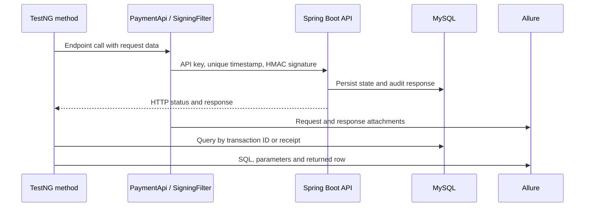

# Test architecture

The `automation/` Maven module drives the bundled backend over HTTP and independently checks MySQL. Start with the [system architecture](architecture.md) for component boundaries; the [backend architecture](backend-architecture.md) owns the API contract and server rules. Setup, configuration and extension commands live in [development](development.md).

## Design choices

- **Four small packages.** Framework code is split by job: `config` reads settings, `api` talks HTTP, `db` reads MySQL, `support` builds test data. There are no base layers or wrappers beyond these.
- **Framework code in `src/main`.** The framework is a library the tests use, so it lives in `automation/src/main/java`. That also puts it under the SpotBugs check in CI, which skips test classes.
- **Tests read as scripts.** `TransactionLifecycleTest` lists the lifecycle steps in order; state-changing calls pair response checks with DB assertions. Nothing is hidden in a workflow class.
- **Explicit test data.** IDs come from the seed data and requests from small factories in `TestData`. The server generates transaction IDs, so tests need no random data and failures are easy to reproduce.
- **Raw responses.** `PaymentApi` returns REST Assured `Response` objects and tests assert with `then()`, so each test shows exactly what it checks.

## Packages

| Package | Classes | Job |
| --- | --- | --- |
| [`config`](../automation/src/main/java/com/qaframework/payments/automation/config) | `TestConfig` | Reads settings: system property, then environment variable, then `config.properties`. |
| [`api`](../automation/src/main/java/com/qaframework/payments/automation/api) | `PaymentApi`, `SigningFilter`, `model/*` | One method per endpoint; signing; request bodies as records. |
| [`db`](../automation/src/main/java/com/qaframework/payments/automation/db) | `Database`, `DbAssertions` | Connection pool; database checks that attach their SQL to the report. |
| [`support`](../automation/src/main/java/com/qaframework/payments/automation/support) | `TestData`, `Transactions` | Seeded IDs and request factories; setup that creates an authorised transaction. |

Tests live in [`automation/src/test/java`](../automation/src/test/java/com/qaframework/payments/automation) and extend `BaseApiTest`, which checks the database is reachable before the suite starts.

## Request signing

[`SigningFilter`](../automation/src/main/java/com/qaframework/payments/automation/api/SigningFilter.java) implements the [backend signing contract](backend-architecture.md#request-signing). Its atomic `nextTimestamp()` counter returns a value larger than the previous one so parallel calls to the same endpoint do not accidentally reuse a signature in the same millisecond.

`RequestSigningTest` builds headers by hand on the unsigned spec (`PaymentApi.unsigned()`) to check each rejection, and signs one request with a fixed timestamp to send it twice for the replay check.

## Database checks

`TransactionLifecycleTest` checks MySQL after each state-changing call:

| After | Checked |
| --- | --- |
| Create | Status `CREATED`; merchant, provider, amount, currency, subscription, duration, renewable flag and request ID match the request |
| Provider validation | Status `PROCESSING` |
| Finalise, charge, renew, cancel | Status `SUCCESS`, `CHARGED`, `RENEWED`, `CANCELLED` |
| Each of the above | A `SUCCESS` audit-log entry for that endpoint |
| Cancel | Subscription `CANCELLED`, renewed at least once, next renewal date set |

The audit table has no transaction column, so `DbAssertions.auditLogged` matches the endpoint name and looks for the transaction ID (or, for provider validation, the receipt) in the logged response. Every check is keyed this way, which keeps parallel and repeated runs independent.

## Reporting

Allure records the calls each test makes:

- each `PaymentApi` and `DbAssertions` call as a named step (through the AspectJ agent configured in `automation/pom.xml`),
- the full request and response, including the signed headers (the official `AllureRestAssured` filter, added after `SigningFilter`),
- SQL issued through `DbAssertions`, its parameters and the returned row. The `BaseApiTest` reachability query uses `Database` directly and is logged without an Allure SQL attachment.

Open the latest report locally with `./mvnw -pl automation allure:serve` after a run. CI archives report artifacts after test execution. Publication to GitHub Pages is limited to successful checked pushes to `main`; failed runs retain diagnostic artifacts without replacing the published report.

## Execution and evidence flow

The lifecycle test exercises `CREATED → PROCESSING → SUCCESS → CHARGED → RENEWED → CANCELLED`. The [backend transition rules](backend-architecture.md#state-transitions) also permit other paths; the tested sequence does not establish exhaustive state-machine coverage. The [README coverage table](../README.md#usage-and-coverage) maps the four classes and 14 methods to their assertions.

## Concurrency and resource lifecycle

TestNG runs methods with a four-thread limit. Business test classes share a stateless `PaymentApi` client across their methods; each API call builds a fresh request specification. Tests that need transaction state create their own server-generated transaction. The shared `SigningFilter` timestamp counter is atomic. The automation's shared Hikari pool allows four connections and closes individual JDBC connections/statements/results with try-with-resources. The backend has its own pool, capped at twelve connections. `BaseApiTest` checks database reachability before the suite; the JVM owns the automation pool for that run.

## Trade-offs

Direct SQL assertions deliberately couple tests to this schema so persistence errors remain visible. They do not replace independent business-level acceptance tests. Per-transaction data and scoped audit queries keep parallel methods and repeated runs independent; they do not prove safe concurrent mutations of the same transaction.

Allure HTTP attachments include signed headers, and SQL attachments include local test data. Use the documented demo credentials and review artifacts before using other environments.

SpotBugs checks framework and backend production classes; its existing `EI_EXPOSE_REP`/`EI_EXPOSE_REP2` suppression allows constructor-injected collaborators. See [the filter](../spotbugs-exclude.xml).
